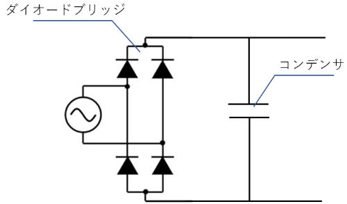
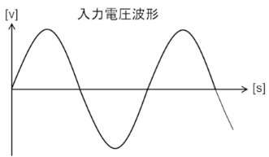
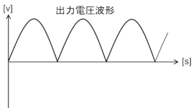
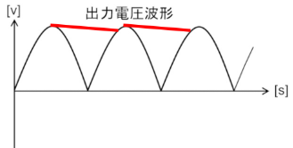
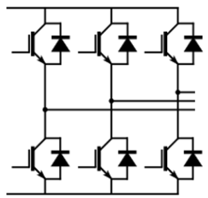
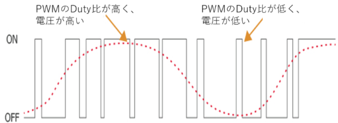

## ロボットを動作させる基礎項目

### コンバータ

コンバータの役割は、**AC電源をDC電源に変える事**です。

コンバータ回路で使われる、メインの回路は**ダイオードブリッジ回路**です。

産業ロボットの回路を作る為には、低電圧指令を満足するよう設計する必要がありますので、細かい事を言うと、このコンバータには、安全設計する為の多くの仕組みを入れる必要がありますが、本記事では、ダイオードブリッジだけに触れたいと思います。

ダイオードブリッジを含む、コンバータの回路は、下記のような回路です。左の電源は工業電源ですので、日本だと200Vである場合が多いです。



__入力電源__  



__ダイオードブリッジ__  



__整流__  

**ダイオードブリッジの後、コンデンサで平滑化され、波形は下記赤線のような波形に変化。**



こうして入力AC電源より、DC電源をつくることが出来た。

この時の電圧は、入力が交流200Vだとすると、200V×√2≒280V程度のDC電源となる。


### インバータの役割

インバータの役割は、DC電源から、**モータを駆動させる、PWM波形を生成する**事です

PWM方式により、矩形波のパルス電圧を出力し、モータのインダクタンスにより、電流は正弦波となります。インバータの回路は単純に下記の図のようになります。



このトランジスタスイッチがオンオフをし、ＰＷＭ制御をする事で、モータを駆動する波形を作ります。

イメージは下の図の通りであり、PWM制御のDuty比を変え、Duty比が高い時は電圧が高く、Duty比が低い時は電圧が低くなり、交流を作ります、そしてその回路が３つついている事で、３相モータを駆動し、ロボットを動かします。



このDutyのコントロールは、コントローラで行っており、どのようにモータを駆動させるべきかを計算し、インバータ内のトランジスタ（IGBT等）を動かします。


## シールド基盤

シールド基板（Shield）は、**マイコン基板（主にArduino）にそのまま被せて機能を拡張する「拡張モジュール」**です。

---

## 役割

### 1. 機能拡張
マイコン本体にはない機能（CAN通信、Ethernet、SDカード、モータードライバなど）を、**追加の回路を載せた基板**として提供します。

### 2. ピン互換で即座に接続
シールドの裏面にはピンソケットが並んでおり、Arduinoの上に**物理的に被せる（スタックする）**だけで電気的に接続されます。配線やはんだ付けが不要です。

```
[CAN Shield]  ← 被せる
[ Arduino ]   ← 被せる
[ ベース板 ]
```

### 3. 複数枚のスタック（一部）
電気的に競合しなければ、複数のシールドを重ねて使えます。

---

## CANシールドの場合

ArduinoにCAN通信機能を追加するシールドです。

| 構成要素 | 役割 |
|----------|------|
| MCP2515（CANコントローラ） | ArduinoがないCANプロトコル処理を担当 |
| TJA1050（CANトランシーバー） | 差動信号変換 |
| 端子台/ピンヘッダ | CAN_H・CAN_Lの接続口 |
| 終端抵抗ジャンパー | 120ΩのON/OFF切り替え |

Arduinoとは **SPIピン（D10〜D13等）** で通信し、Arduino側はライブラリを使って `CAN.sendMsgBuf()` のように簡単に扱えます。

シールド基板としてよく使われる機能は以下の通りです。

---

## よく使われるシールドの種類

| シールド | 主な機能 | 用途例 |
|----------|----------|--------|
| **Ethernetシールド** | 有線LAN通信（WizNet W5100等） | IoT機器のネットワーク接続、Webサーバ |
| **CANシールド** | CANバス通信（MCP2515+TJA1050） | 車載診断、産業用機器接続 |
| **モーターシールド** | DCモーター/ステッピングモーター駆動（L298P, DRV8835等） | ロボット走行、CNC制御 |
| **リレーシールド** | 高電圧・大電流機器のON/OFF制御 | 家電制御、自動化システム |
| **SDカードシールド** | データの記録・読み出し | ログ保存、設定ファイル読み込み |
| **GPSシールド** | 位置情報の取得 | 車両追跡、測量機器 |
| **GSM/GPRSシールド** | 携帯電話回線による通信 | SMS通知、リモートモニタリング |
| **センサーシールド** | 各種センサー接続用基板（I2C, アナログピン拡張） | 温湿度、加速度、気圧等の測定 |
| **プロトタイピングシールド** | ブレッドボードやはんだ付け用の空き配線領域 | オリジナル回路の試作 |
| **LCDシールド** | 文字・グラフィック表示（1602, 12864等） | ステータス表示、簡易UI |
| **MP3シールド** | 音声ファイルの再生 | アラーム、案内放送 |
| ** Joystick / ゲームパッドシールド** | 入力インターフェース | ゲーム機、RC送信機 |

---

## 特に人気の高い3つ

1. **Ethernetシールド**：IoT入門の定番。Arduinoをインターネットに接続する最も簡単な方法
2. **モーターシールド**：教育用ロボットキットで広く採用。配線なしでモーターを回せる
3. **CANシールド**：自動車・産業分野で必須。OBD-II診断や車載機器のプロトタイプに使用

---

## まとめ

> シールド基板は、**「被せるだけで通信・駆動・記録・表示・入力」などの機能を即座に追加する**拡張モジュールです。中でも**Ethernet、CAN、モーター、SDカード、リレー**が最も汎用的で、Makerから産業プロトタイプまで幅広く使われています。
