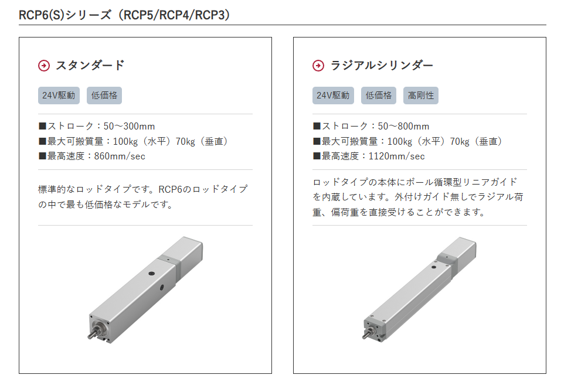
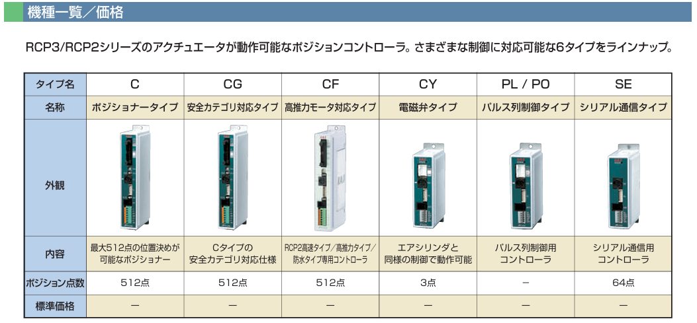

## ロボシリンダ

IAI社のロボシリンダ **RCS2-RA5C**（モーターストレート・カップリングタイプ）の寸法は以下の通りです。<source-chip title="IAI - RCS2-RA5C" url="https://www.iai-robot.co.jp/product/details/RCS2-RA5C/index.html" /><source-chip title="IAI - RCS-RA55→RCS2-RA5C置換え" url="https://www.iai-robot.co.jp/product/pdf/22_RCS-RA55(RA55R)%E2%86%92RCS2-RA5C(RA5R)%E7%BD%AE%E6%8F%9B%E3%81%88.pdf" />

### 基本外形寸法

| 項目 | 寸法 |
|------|------|
| 本体幅 | 55 mm |
| 本体高さ | 55 mm |
| ロッド径 | φ30 mm |
| ロッド先端ねじ径 | M14 |
| 本体取付用T溝間隔 | 26 mm |
| ロッド側取付タップ穴 | 縦横 44 mm 間隔、穴径 M6 |
| 原点時・ロッド側端面からロッド先端まで | 52 mm |

---

### ストローク別 全長寸法

ストローク（ST）は 50 mm ～ 300 mm（50 mm ピッチ）の範囲です。

#### 60W モーター

| ストローク | 50 | 100 | 150 | 200 | 250 | 300 |
|------------|-----|-----|-----|-----|-----|-----|
| **L（ブレーキ無し）** | 230 | 280 | 330 | 380 | 430 | 480 |
| **L（ブレーキ有り）** | 302.5 | 352.5 | 402.5 | 452.5 | 502.5 | 552.5 |
| **B（ベース長）** | 138 | 188 | 238 | 288 | 338 | 388 |

#### 100W モーター

| ストローク | 50 | 100 | 150 | 200 | 250 | 300 |
|------------|-----|-----|-----|-----|-----|-----|
| **L（ブレーキ無し）** | 248 | 298 | 348 | 398 | 448 | 498 |
| **L（ブレーキ有り）** | 320.5 | 370.5 | 420.5 | 470.5 | 520.5 | 570.5 |
| **B（ベース長）** | 138 | 188 | 238 | 288 | 338 | 388 |

※ L＝全体全長、B＝取付ベースの長さです。

---

### 旧製品（RCS-RA55）からの変更点

旧モデルから置換える場合、以下の点にご注意ください。

- 本体幅・高さは同じ 55 mm
- 全長は旧製品より短くなりました（60Wブレーキ無しの場合：旧 ST+257.5 → 現行 ST+232）
- 取付T溝間隔：30 mm → 26 mm
- ロッド側タップ穴：対角 65 mm（M5）→ 縦横 44 mm（M6）
- ロッド先端ねじ径：M12 → M14

---

### 質量（参考）

| ストローク | 50 | 100 | 150 | 200 | 250 | 300 |
|------------|------|------|------|------|------|------|
| 60W ブレーキ無し | 1.9 kg | 2.2 kg | 2.5 kg | 2.8 kg | 3.1 kg | 3.4 kg |
| 100W ブレーキ無し | 2.1 kg | 2.4 kg | 2.7 kg | 3.0 kg | 3.3 kg | 3.6 kg |

詳細な2D/CAD図面は、IAIの公式サイトから「パラメトリックCAD図面」または「寸法図」でダウンロード可能です。

## ドライバ

IAI社の **RCS2-RA5C** に対応するコントローラー（ドライバー）は、用途や軸数、制御方法に応じて以下のラインナップがあります。<source-chip title="IAI - RCS2-RA5C" url="https://www.iai-robot.co.jp/product/details/RCS2-RA5C/index.html" />

---

## 1軸用コントローラー（単軸制御）

### SCON-CB / CGB
- **軸数**: 1軸
- **電源**: 単相AC 100V / 200V
- **制御方法**: ポジショナー、パルス列、各種ネットワーク
- **対応ネットワーク**: DeviceNet、CC-Link、CIE、CIT、PROFIBUS、CANopen、MECHATROLINK、MECHATROLINK-III、EtherCAT、EtherNet/IP、PROFINET、SSCNET、ECM
- **特徴**: 1軸アクチュエーター制御のスタンダードモデル。位置決め点数は最大512点（ネットワーク仕様は768点）。

### SCON2-CG
- **軸数**: 1軸
- **電源**: 単相AC 100V または 単相AC 200V
- **制御方法**: ポジショナー、パルス列、各種ネットワーク
- **対応ネットワーク**: DeviceNet、CC-Link、CIE、CIT、EtherCAT、EtherNet/IP、PROFINET、SSCNET
- **特徴**: SCONの後継モデルで、安全モニタ機能を搭載。フェンスレス運転が可能。位置決め点数は最大384点。

---

## マルチ軸・プログラム制御用コントローラー

### XSEL-RA / SA
- **軸数**: 最大8軸
- **電源**: 単相AC 200V / 三相AC 200V
- **制御方法**: プログラム（SEL言語）、各種ネットワーク
- **対応ネットワーク**: DeviceNet、CC-Link、CIE、CIT、PROFIBUS、EtherCAT、EtherNet/IP
- **特徴**: 複数軸を1台で統合制御。最大位置決め点数は55,000点（タイプによる）。

### XSEL2-TS / TL
- **軸数**: 最大8軸
- **電源**: 単相AC 100V / 単相AC 200V / 三相AC 200V
- **制御方法**: プログラム（SEL言語）、各種ネットワーク
- **対応ネットワーク**: DeviceNet、CC-Link、CIE、CIT、EtherCAT、EtherNet/IP、PROFINET、SSCNET
- **特徴**: XSELの後継モデル。最大位置決め点数は36,000点。

### RSEL
- **軸数**: 最大8軸
- **制御方法**: プログラム（SEL言語）、各種ネットワーク
- **対応ネットワーク**: DeviceNet、CC-Link、CIE、CIT、PROFIBUS、EtherCAT、EtherNet/IP、PROFINET
- **特徴**: RCONシステムに組み込むSELプログラム制御ユニット。

---

## 分散制御システム（モジュール型）

### RCON
- **軸数**: 最大16軸（ML3、SSN、ECMは最大8軸）
- **電源**: DC24V / 単相AC 200V / 三相AC 200V
- **制御方法**: 各種ネットワーク（ポジショナー・パルス列非対応）
- **対応ネットワーク**: DeviceNet、CC-Link、CIE、CIT、PROFIBUS、MECHATROLINK、MECHATROLINK-III、EtherCAT、EtherNet/IP、PROFINET、SSCNET、ECM
- **特徴**: ゲートウェイユニット＋ドライバーユニット（RCON-SC等）のモジュール構成。最大位置決め点数128点（ML3、SSN、ECMはポジションデータなし）。

---

## まとめ表

| コントローラー | 軸数 | 電源 | ポジショナー | パルス列 | プログラム | 主なネットワーク対応 |
|--------------|------|------|-------------|----------|-----------|---------------------|
| **SCON-CB/CGB** | 1軸 | AC100/200V | ○ | ○ | - | 豊富（DN, CC, EC, E/IP等） |
| **SCON2-CG** | 1軸 | AC100/200V | ○ | ○ | - | EC, E/IP, PN, SSN等 |
| **XSEL-RA/SA** | 最大8軸 | AC200V 単相/三相 | - | - | ○ | DN, CC, EC, E/IP等 |
| **XSEL2-TS/TL** | 最大8軸 | AC100/200V 単相/三相 | - | - | ○ | DN, CC, EC, E/IP, PN, SSN |
| **RSEL** | 最大8軸 | - | - | - | ○ | DN, CC, EC, E/IP, PN |
| **RCON** | 最大16軸 | DC24V / AC200V | - | - | - | 豊富（DN, CC, EC, E/IP, PN, ML, ML3, SSN, ECM等） |

---

## 選定のポイント

- **1軸だけを単独で動かしたい** → SCON-CB/CGB または SCON2-CG
- **複数軸を連動・プログラム制御したい** → XSEL-RA/SA または XSEL2-TS/TL
- **PLCや上位ネットワークから分散制御したい** → RCON システム
- **安全規格対応（フェンスレス）が必要** → SCON2-CG（安全モニタ機能付き）

RCS2-RA5Cは200Vサーボモータ搭載のため、上記いずれのコントローラーでも動作可能です。ご用途に応じてお選びください。

## DC24Vで動作可能なシリンダ

IAIのロボシリンダでDC 24V駆動が可能なものは存在しますが、**RCS2-RA5Cは200V ACサーボモータ搭載のため、DC 24Vでは動作しません**。<source-chip title="IAI - RCS2-RA5C" url="https://www.iai-robot.co.jp/product/details/RCS2-RA5C/index.html" /><source-chip title="IAI - SSEL→RSEL置換え注意点" url="https://www.iai-robot.co.jp/product/pdf/59_SSEL_RSEL.pdf" />

---

## RCS2-RA5C に関する注意点

RCS2シリーズは**200V ACサーボモータ**を搭載しており、対応コントローラーもSCON（AC100/200V）、XSEL（AC200V）、RSEL/RCON（モーター駆動用AC200V）など、**モーター駆動電源としてAC200Vが必要**です。

RCONシステムにDC24Vの仕様が存在しますが、これは制御用電源（ゲートウェイユニット・RSELの制御回路用）であり、**モーターを駆動するドライバーユニット（RCON-SC等）には単相/三相AC200Vが必要**です。

---

## DC 24V で動作する IAI ロボシリンダ・コントローラー

DC 24V駆動が可能なシリーズとコントローラーは以下の通りです。

### 1. RCP6 / RCP6S シリーズ（パルスモーター / DCブラシレスサーボ）

| 項目 | 内容 |
|------|------|
| 駆動電圧 | DC 24V |
| 対応コントローラー | **PCON-CB / CFB**、RCP6S内蔵コントローラー |
| 特徴 | パルスモーターまたはDCブラシレスモーター。コントローラーが低価格。 |
| 最大可搬質量 | 水平100kg / 垂直55kg（機種による） |
| 最大速度 | 1,440 mm/s |

※ RCP2～RCP6のアクチュエーターに対応。一部機種には変換ユニットが必要です。<source-chip title="IAI - RCP6Sコントローラー" url="https://www.iai-robot.co.jp/product/pdf/catarog/ct/RCM-P6_C.pdf" />

---

### 2. RCA2 シリーズ（24Vサーボ）

| 項目 | 内容 |
|------|------|
| 駆動電圧 | DC 24V |
| 対応コントローラー | ACON-CB / DCON-CB 等 |
| 特徴 | 24V駆動のサーボモータータイプ |
| 最大可搬質量 | 水平18kg / 垂直6kg |
| 最大速度 | 1,300 mm/s |

---

### 3. エレシリンダー（ECシリーズ）

| 項目 | 内容 |
|------|------|
| 駆動電圧 | DC 24V |
| 特徴 | コントローラー一体型。2点間位置決めに特化。 |
| 最大可搬質量 | 水平400kg / 垂直120kg |
| 最大速度 | 2,000 mm/s |

---

### 4. 旧 RCS-C（DC24V）→ ACON-CB 置換え

| 項目 | 内容 |
|------|------|
| 旧製品 | RCS-C（DC24Vタイプ） |
| 代替機種 | **ACON-CB** |
| 対応アクチュエーター | RCS-SA4 / SA5 / SA6（スライダタイプのみ） |
| 注意 | ロッドタイプ（RA35/RA45等）は置換え不可 |

※ RCS-C(24V)は生産中止となり、一部機種のみACON-CBへの置換えが可能です。<source-chip title="IAI - RCS-C(24V)→ACON-CB置換え" url="https://www.iai-robot.co.jp/product/pdf/19_RCS-C(24V)%E2%87%92ACON-CB%E7%BD%AE%E6%8F%9B%E3%81%88%E8%B3%87%E6%96%99Rev1.pdf" />

---

## まとめ

| シリーズ | 駆動電圧 | RCS2-RA5Cと同クラスの負荷能力 |
|----------|----------|------------------------------|
| **RCS2-RA5C** | **AC200V** | **水平60kg / 垂直18kg** |
| RCP6 | DC24V | 水平100kg / 垂直55kg |
| RCA2 | DC24V | 水平18kg / 垂直6kg |
| エレシリンダー | DC24V | 水平400kg / 垂直120kg |

**結論として、RCS2-RA5CをDC 24Vで駆動することはできません。** DC 24V電源でロボシリンダを使用したい場合は、**RCP6シリーズ**（PCON-CB/CFBコントローラー）が最も近い代替となります。負荷条件やストロークなどの詳細があれば、より適切な機種をご案内できます。

## スチュアートプラットホーム用

上記3つの中でスチュアートプラットフォームのシリンダとして利用可能なのは、**RCP6（ロッドタイプ）**です。<source-chip title="IAI - ロッドタイプ シリーズ一覧" url="https://www.iai-robot.co.jp/product/series/rod.html" /><source-chip title="IAI - RCP6-RA6C" url="https://www.iai-robot.co.jp/product/details/RCP6_RCP6S-RA6C/index.html" />



## 結論：RCP6 のロッドタイプ（RA6C 等）が最も適しています

### 理由

スチュアートプラットフォームは、6本の「伸縮する脚（ロッドタイプ）」で天板を支える並列機構です。選定のポイントは以下の3つです。

| 選定ポイント | 必要条件 |
|-------------|---------|
| **構造** | ロッドタイプ（伸縮する棒状アクチュエータ） |
| **推力** | プラットフォームの自重＋搭載物を6本で支える十分な推力 |
| **制御** | 6軸の長さを個別・連続的に制御できること |

---

## 各シリーズの評価

### 1. RCP6（ロッドタイプ）→ 利用可能

| 項目 | 内容 |
|------|------|
| ロッドタイプ | **あり**（RCP6-RA6C、RA10C 等） |
| 推力 | 水平100kg / 垂直55kg。プラットフォームの脚として十分な推力 |
| ストローク | 50～1500mm。スチュアートプラットフォームの可動範囲に応じて選定可能 |
| 制御 | PCON-CB/CFB（1軸制御）。6台＋上位PLC/PCで6軸制御が可能 |
| 備考 | バッテリーレスアブソリュートエンコーダー標準搭載で、原点復帰不要 |

**注意点**：PCON-CB/CFBは1軸制御のコントローラーなので、6軸の同期制御には上位システム（PLCやPC）で逆運動学を計算し、各軸に位置指令を出す構成が必要です。フィールドネットワーク（CC-Link、DeviceNet、EtherCAT等）で6台のPCONを接続すれば、実用的なスチュアートプラットフォームが構築できます。

---

### 2. RCA2 → 実用上 不向き

| 項目 | 内容 |
|------|------|
| ロッドタイプ | 限定的（RCA2-RA2AC 等の小型のみ）。主な製品はスライダタイプ |
| 推力 | 水平18kg / 垂直6kg。スチュアートプラットフォームの脚としては推力不足の場合が多い |
| 備考 | RCAシリーズ（RCA-RA3C/RA4C）には24Vサーボのロッドタイプがありますが、RCA2シリーズとしてのロッドタイプは小型で選択肢が少ない |

---

### 3. エレシリンダー → 制御面で不向き

| 項目 | 内容 |
|------|------|
| ロッドタイプ | 存在する（EC-R□、EC-RR□ 等のラジアルシリンダー） |
| 推力 | 水平400kg / 垂直120kg。推力は十分 |
| 制御 | **コントローラー一体型で2点間位置決めに特化** |
| 備考 | スチュアートプラットフォームでは、各脚の長さをリアルタイムで連続的に変化させる必要があります。エレシリンダーは基本的に「A地点→B地点」の位置決めが前提で、軌跡中の中間位置を逐次指令したり、6軸を厳密に同期させたりする制御には不向きです |

---

## まとめ

| シリーズ | ロッドタイプ | 推力 | 6軸同期制御 | 総合評価 |
|----------|------------|------|------------|----------|
| **RCP6（ロッドタイプ）** | ◎ | ◎ | △（上位システムが必要） | **利用可能** |
| RCA2 | △（小型のみ） | △（推力不足） | △ | 実用上 不向き |
| エレシリンダー | ◎ | ◎ | ✕（2点間位置決め特化） | 制御面で不向き |

**結論として、3つの中からスチュアートプラットフォームのシリンダを選ぶなら「RCP6 のロッドタイプ（RA6C 等）」が最も適しています。** ただし、6軸の逆運動学計算と同期制御は上位のPLCやPCで行う必要があります。

もしプラットフォームの想定荷重や可動範囲（ストローク）をお教えいただければ、RCP6の中からより具体的な型式（ロッド径、リード、ストローク）をご案内できます。

## ドライバ

### 1軸用 ポジショナー型

**PCON-CB / CFB**
- 対応モーター：パルスモーター（RCP6）、サーボモーター、DCブラシレスモーター
- 電源：DC 24V
- 制御方法：ポジショナー（I/O点からの位置番号指定）、パルス列入力
- 対応ネットワーク：DeviceNet、CC-Link、PROFIBUS、CANopen、MECHATROLINK、EtherCAT、EtherNet/IP 等
- 特徴：RCP6の標準的な1軸コントローラー。バッテリーレスアブソリュートエンコーダーに対応 [IAI RCP6Sコントローラー](https://www.iai-robot.co.jp/product/pdf/catarog/ct/RCM-P6_C.pdf)


### プログラム型コントローラー（SEL言語による多軸制御）

**SSEL（1軸 / 2軸プログラムコントローラー）**
- 対応アクチュエーター：RCP2～RCP6、RCA、RCA2、RCD 等
- 電源：DC 24V
- 制御方法：プログラム運転（SEL言語）
- 特徴：1台で最大2軸までプログラム制御可能

**MSEL（多軸プログラムコントローラー）**
- 対応アクチュエーター：RCP2～RCP6、RCA、RCA2、RCD 等
- 電源：DC 24V
- 制御方法：プログラム運転（SEL言語）
- 特徴：1台で最大4軸（機種による）まで統合制御可能 [IAI コントローラーシリーズ一覧](https://www.iai-robot.co.jp/product/series/control.html)

### モジュール型・分散制御システム

**R-unit システム（RCON / RSEL / REC）**
- 構成：マスターユニット＋ドライバーユニット（RCON-PC/AC/DC等）
- 対応モーター：24V系（パルス/サーボ/DCブラシレス）と200Vサーボの混在制御が可能
- 電源：制御用 DC 24V、モーター駆動用は機種による
- 特徴：必要軸数だけドライバーユニットを連結するモジュール型。省配線・省スペース化を実現 [IAI コントローラーシリーズ一覧](https://www.iai-robot.co.jp/product/series/control.html)

### 内蔵コントローラータイプ

**RCP6S（コントローラー内蔵型アクチュエーター）**
- 特徴：アクチュエーター本体にコントローラーが内蔵済み。外部コントローラー不要。
- 制御方法：PCON-CB/CFBと同じ制御が可能 [IAI RCP6Sコントローラー](https://www.iai-robot.co.jp/product/pdf/catarog/ct/RCM-P6_C.pdf)

## スチュアートプラットフォーム向け選定ガイド

| 用途 | 推奨コントローラー | 理由 |
|------|-------------------|------|
| 上位PLC/PCで逆運動学を計算し、各軸に個別指令を出す構成 | **PCON-CB/CFB × 6台** | フィールドネットワークで6台をPLCに接続。最も柔軟で汎用的な構成。 |
| IAIコントローラー内でプログラム制御を行いたい | **MSEL または R-unit（RSEL）** | 1台で複数軸を統合制御。ただし6軸全てを1台で制御するには軸数が不足する場合があり、2台以上の構成が必要。 |
| 省配線・省スペースを最重視 | **RCP6S（内蔵コントローラー）× 6台** | 各脚にコントローラーが内蔵されているため、配線が最小限に。 |


## 重要な注意点

- **PSEL**：主にRCP2/RCP3シリーズ向けのプログラムコントローラーであり、RCP6のロッドタイプ（RA6C/RA10C等）には対応していません [IAI PSELコントローラー](https://www.iai-robot.co.jp/product/pdf/catarog/ct/PSEL.pdf)
- **XSEL**：200Vサーボモーター（RCS2シリーズ等）を主対象とした多軸プログラムコントローラーであり、RCP6（24Vパルスモーター）との組み合わせは非対応です


## まとめ

| コントローラー | 対応軸数 | 制御方法 | スチュアートプラットフォーム向け評価 |
|--------------|---------|----------|-----------------------------------|
| **PCON-CB/CFB** | 1軸 | ポジショナー/パルス列 | **最も推奨**。6台＋上位PLC/PCで6軸制御。 |
| **SSEL** | 1～2軸 | プログラム | 軸数不足で不向き |
| **MSEL** | 最大4軸 | プログラム | 6軸には2台必要 |
| **R-unit（RSEL）** | 最大8軸 | プログラム | 統合制御が可能だが、逆運動学の実装に制約あり |
| **RCP6S（内蔵型）** | 1軸（内蔵） | ポジショナー | 配線の簡素化に最適 |

スチュアートプラットフォームで6軸をリアルタイムに同期制御するには、**PCON-CB/CFBを6台使用し、EtherCATやMECHATROLINKなどのフィールドネットワークで上位PLCに接続する構成**が最も一般的で確実です。



## ロッドの選定

寸法が40角程度のもの

RCP6-RA4C

https://www.iai-robot.co.jp/product/details/RCP6_RCP6S-RA4C/index.html


## コントローラ

PCON-CBベース

https://www.iai-robot.co.jp/product/pdf/catarog/ct/PCON-C.pdf

PCONを使って **RCP6-RA4C** を制御する場合の適切なドライバ型式は以下の通りです。

---

## RCP6-RA4C の仕様確認

まず、アクチュエータ側の仕様を確認します。

| 項目 | RCP6-RA4C |
|------|-----------|
| シリーズ | RCP6（ロッドタイプ） |
| モーター | 56角パルスモーター（**56P**） |
| エンコーダー | バッテリーレスアブソリュート（**WAI**） |
| 電源電圧 | DC 24V |

[IAI - RCP6-RA4C](https://www.iai-robot.co.jp/product/details/RCP6_RCP6S-RA4C/index.html)

---

## PCON-CB/CFB の型式体系

PCON-CB/CFB の型式は以下の構成となります。

```
PCON-□-□□-□□□-□□-□-□
```

| 項目 | 記号 | 説明 |
|------|------|------|
| **タイプ** | CB / CFB / CGB / CGFB | CB＝標準、CFB＝フィールドネットワーク対応、CGB/CGFB＝安全カテゴリ対応 |
| **モーター種類** | 56P | 56角パルスモーター（RCP6-RA4C対応） |
| **エンコーダー種類** | WAI | バッテリーレスアブソリュートエンコーダー |
| **I/O種類** | NP / PN / CC / DV 等 | NP＝NPN、PN＝PNP、CC＝CC-Link、DV＝DeviceNet 等 |
| **I/Oケーブル長さ** | 0 / 2 / 3 / 5 | 0＝ケーブルなし、2＝2m、3＝3m、5＝5m |
| **電源電圧** | 0 | 0＝DC24V |

[IAI - PCONカタログ](https://www.iai-robot.co.jp/product/pdf/catarog/ct/PCON-C.pdf)  
[IAI - PCON-CB/CFB First Step Guide](https://www.shopos.vn/medias/items/files/2025/03/Catalog_PCON-CA_CFA(ME0303-7A)%20IAI.pdf)

---

## 推奨型式

### 基本型（NPN I/O仕様）

```
PCON-CB-56P-WAI-NP-0-0
```

| 要素 | 内容 |
|------|------|
| PCON-CB | 標準ポジショナータイプ |
| 56P | 56角パルスモーター対応 |
| WAI | バッテリーレスアブソリュートエンコーダー |
| NP | NPN I/O仕様 |
| 0 | I/Oケーブルなし |
| 0 | DC24V |

### PNP I/O仕様の場合

```
PCON-CB-56P-WAI-PN-0-0
```

### フィールドネットワーク対応（CC-Link）の場合

```
PCON-CFB-56P-WAI-CC-0-0
```

### フィールドネットワーク対応（DeviceNet）の場合

```
PCON-CFB-56P-WAI-DV-0-0
```

---

## スチュアートプラットフォーム用途での選定ポイント

スチュアートプラットフォームで6軸を上位PLCと連携する場合は、**フィールドネットワーク対応の PCON-CFB** が推奨されます。

| 用途 | 推奨型式例 |
|------|-----------|
| 上位PLC（三菱電機）とCC-Linkで接続 | `PCON-CFB-56P-WAI-CC-0-0` |
| 上位PLC（オムロン等）とDeviceNetで接続 | `PCON-CFB-56P-WAI-DV-0-0` |
| EtherCAT対応PLCと接続 | `PCON-CFB-56P-WAI-EC-0-0` |
| 汎用I/O（NPN）でPLCと接続 | `PCON-CB-56P-WAI-NP-2-0` |

---

## 注意点

1. **PCON-CA/CFAは受注中止**：PCON-CA/CFAは2024年9月をもって受注中止となり、**PCON-CB/CFB** への置換えが必要です。フィールドバスモジュールが50pinから60pinに変更になっています。  
   [IAI - PCON-CA/CFA→CB/CFB置換え](https://www.iai-robot.co.jp/product/pdf/54_PCON-CA_CFA%E3%81%8B%E3%82%89CB_CFB.pdf)

2. **ケーブルは別途必要**：型式末尾が `0-0`（ケーブルなし）の場合、以下のケーブルを別途ご注文ください。
   - モーターケーブル：`CB-RCP2-MA***`（標準1m/3m/5m）
   - エンコーダケーブル：`CB-RFA-PA***`（標準1m/3m/5m）  
   [IAI - PCONカタログ](https://www.iai-robot.co.jp/product/pdf/catarog/ct/PCON-C.pdf)

3. **I/Oケーブル**：PCON-CBの場合、I/Oケーブル `CB-PAC-PIO020`（標準2m）がコントローラに付属します。ケーブル長さを `2` にすると2mケーブル付属の仕様となります。

---

## まとめ

| 項目 | 内容 |
|------|------|
| **最も基本的な型式** | `PCON-CB-56P-WAI-NP-0-0` |
| **スチュアートプラットフォーム推奨** | `PCON-CFB-56P-WAI-CC-0-0`（CC-Link例） |
| **モーター** | 56P（56角パルスモーター） |
| **エンコーダー** | WAI（バッテリーレスアブソリュート） |
| **電源** | DC24V |

ご使用のPLCメーカー・通信規格（CC-Link、DeviceNet、EtherCAT等）をお教えいただければ、より具体的なネットワーク仕様の型式をご案内できます。

型式：PCON-CFB-56P-WAI-CC-0-0

## 制御前提

ラズパイ（Raspberry Pi）で **PCON-CFB（CC-Link仕様）** を制御する場合、**直接的なCC-Link通信は現実的ではありません**。以下に理由と、実現可能な代替案を示します。

---

## 1. なぜ直接CC-Linkは困難か

CC-Linkは三菱電機の専用フィールドバス規格で、以下の課題があります。

| 課題 | 内容 |
|------|------|
| **専用通信ICが必要** | CC-Linkスレーブ機能を実現するには、三菱電機認定の通信ASIC（例：MFP3）が必要 |
| **ラズパイ用スタックが存在しない** | 一般的なオープンソース実装がなく、プロトコル解析から実装する必要がある |
| **物理層の問題** | CC-LinkはRS-485ベースの独自タイミング通信で、単純なUARTでは対応困難 |

[CC-Link Partner Association - 開発フロー](https://www.cc-link.org/en/development/cclinkie_tsn_flow/index.html)

---

## 2. 実現可能な方法（3つのアプローチ）

### 方法A：ゲートウェイを使う（推奨：既存CC-Link仕様を維持する場合）

CC-Link ↔ Ethernet/Modbus/シリアル 変換ゲートウェイを介してラズパイと接続します。

| ゲートウェイ製品 | 変換仕様 | 概算価格帯 |
|-----------------|---------|-----------|
| **Hilscher netTAP 50** | CC-Link Slave ↔ Ethernet または Serial(Modbus) | 約4～5万円 |
| **Hilscher netTAP 100** | CC-Link ↔ PROFINET/EtherCAT/EtherNet/IP | 約6～8万円 |
| **Anybus X-gateway** | CC-Link Slave ↔ 各種イーサネット | 約5～7万円 |

**接続構成例：**
```
[ラズパイ] ←Ethernet/Modbus RTU→ [netTAP 50] ←CC-Link→ [PCON-CFB-56P-WAI-CC-0-0]
```

ラズパイ側は **Python + pymodbus** や **ソケット通信** でゲートウェイを制御し、ゲートウェイがCC-Linkプロトコルに変換します。

[Hilscher netTAP 50 CC-Link Gateway](https://www.hilscher.com/products/gateways-switches-for-industrial-communication/gateways-for-industrial-ethernet-fieldbus-serial/nt-50-cc-en)  
[Hilscher netTAP選定ガイド](https://www.hilscher.com/fileadmin/user_upload/ja/resources/Documents_JA/SelGuide_netTAP_01_2024-JP.pdf)

---

### 方法B：PCONの通信仕様を変更する（推奨：ラズパイとの親和性重視）

CC-Link仕様のPCONを、**ラズパイと直接通信しやすい仕様**に変更します。

#### 案B-1：EtherCAT仕様に変更（最も推奨）

```
PCON-CFB-56P-WAI-EC-0-0  （EC = EtherCAT）
```

**メリット：**
- ラズパイに **CODESYS Runtime** をインストールすれば、EtherCATマスターとして動作可能
- リアルタイム性が確保でき、6軸同期制御にも適している
- オープンソースの **SOEM (Simple Open EtherCAT Master)** ライブラリも利用可能

```
[ラズパイ + CODESYS/SOEM] ←EtherCAT→ [PCON-CFB-56P-WAI-EC-0-0] ×6台
```

[IAI - EtherCAT Instruction Manual](https://www.iai-automation.com/en/controller-manuals.html?file=files%2Fcontent%2Fdownloads%2Fmanuals%2Finstruction%2FETHERCAT%28ME0273%29.pdf)  
[CODESYS on Raspberry Pi](https://www.codesys.com/products/codesys-runtime/raspberry-pi-sl.html)

#### 案B-2：DeviceNet仕様に変更

```
PCON-CFB-56P-WAI-DV-0-0  （DV = DeviceNet）
```

**メリット：**
- CANベースのオープン規格で、**ラズパイ + CAN HAT（PiCAN等）** で直接通信可能
- Python + `python-can` ライブラリで制御プログラムを構築可能

```
[ラズパイ + PiCAN HAT] ←CAN/DeviceNet→ [PCON-CFB-56P-WAI-DV-0-0] ×6台
```

[IAI - DeviceNet Quick Start Guide](https://www.iai-robot.co.jp/download/q_start/pdf/Q_START_A_D_PCON_DEVICENET(MJ0437).pdf)

#### 案B-3：シリアル通信仕様（SEタイプ）に変更

```
PCON-SE-56P-WAI-N-0-0  （SE = Serial RS-232C/RS-485）
```

**メリット：**
- ラズパイのUARTポート（RS-232C/RS-485変換）で直接通信
- IAIの **RCM-101-USB** 設定ツールと同じプロトコルで、位置データの読み書きが可能
- 最もシンプルで低コスト

```
[ラズパイ UART] ←RS-232C/RS-485→ [PCON-SE-56P-WAI-N-0-0] ×6台
```

[IAI - PCONカタログ（SEタイプ）](https://www.iai-robot.co.jp/product/pdf/catarog/ct/PCON-C.pdf)

---

### 方法C：I/O直接制御（最もシンプル）

CC-Link/ネットワーク仕様をやめ、**標準I/O（NPN/PNP）仕様**にして、ラズパイのGPIOで直接制御します。

```
PCON-CB-56P-WAI-NP-0-0  （NP = NPN I/O）
```

**接続：**
- ラズパイGPIO → 光カプラ絶縁 → PCONのI/O端子（CSTR, PC1～PC256, SON等）
- 位置決めは「ポジショナーモード」で、ポジション番号をバイナリ入力してCSTRでスタート

**メリット：**
- 通信プロトコル不要で最も確実
- ラズパイのGPIO + 簡易トランジスタ回路で実現可能

**デメリット：**
- 配線が多い（6軸分のI/O配線が必要）
- ポジションデータの書き換えはIA-OS（PCソフト）が必要

[IAI - PCON I/O仕様](https://www.iai-robot.co.jp/product/pdf/catarog/ct/PCON-C.pdf)

---

## 3. スチュアートプラットフォーム用途での推奨構成

スチュアートプラットフォーム（6軸同期制御）の場合、以下の優先順位を推奨します。

| 優先度 | 方式 | 理由 |
|--------|------|------|
| **1位** | **EtherCAT（PCON-CFB-EC）+ ラズパイ(CODESYS/SOEM)** | リアルタイム性・同期性が最も高い。6軸同時制御に最適 |
| **2位** | **DeviceNet（PCON-CFB-DV）+ ラズパイ(PiCAN)** | CANベースで比較的容易。同期精度はEtherCATに劣る |
| **3位** | **シリアルSEタイプ + ラズパイ(UART)** | シンプルだが6軸同時制御の同期性に課題あり |
| **4位** | **I/O直接制御（PCON-CB-NP）+ ラズパイ(GPIO)** | 最も簡単だが、配線・柔軟性に課題 |
| **5位** | **CC-Link + ゲートウェイ** | コスト高・構成複雑。既存設備との統合が必要な場合のみ |

---

## 4. まとめ

**結論：ラズパイでCC-Link仕様のPCONを直接制御することは現実的ではありません。**

| あなたの状況 | 推奨アクション |
|-------------|--------------|
| CC-Link仕様のPCONを既に購入済み | **Hilscher netTAP等のゲートウェイ**を追加購入 |
| これから選定する段階 | **EtherCAT仕様（EC）に変更**し、ラズパイ+CODESYSで制御 |
| 最も低コスト・簡単に実現したい | **I/O直接制御（NP仕様）** または **SEシリアル仕様** に変更 |

EtherCAT仕様に変更する場合の型式例：
```
PCON-CFB-56P-WAI-EC-0-0
```

ご使用のラズパイのモデル（Pi 4/Pi 5等）と、リアルタイム性の要求レベルをお教えいただければ、より具体的な接続構成（CODESYS vs SOEM vs Python-can等）をご案内できます。


1. 一番制御が楽：

EtherCAT仕様（EC）に変更し、ラズパイ+CODESYS(パッケージ)で制御

納期が5カ月かかりそう。

2. 2番手：

DeviceNet（PCON-CFB-DV）+ ラズパイ(PiCAN)

こちらは納期なんとかなりそう。

