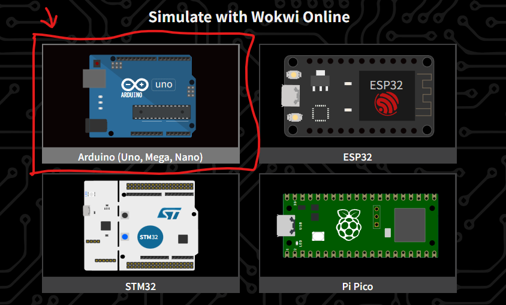
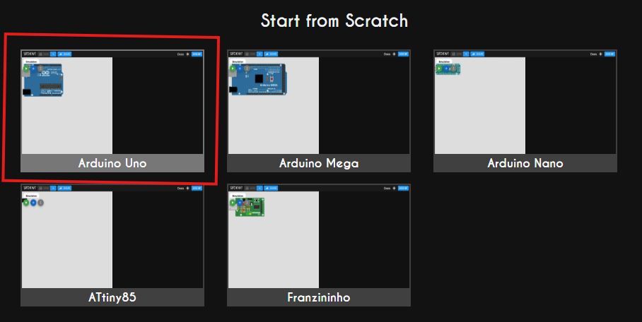
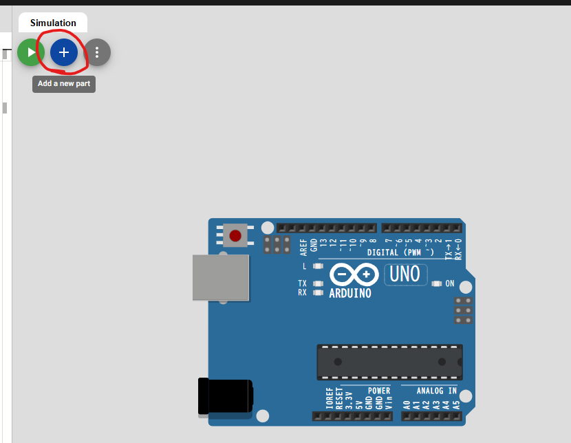
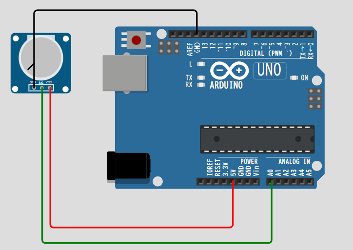
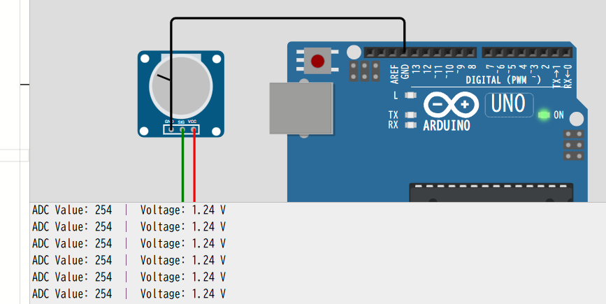
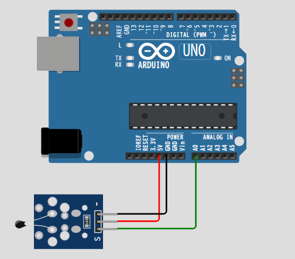
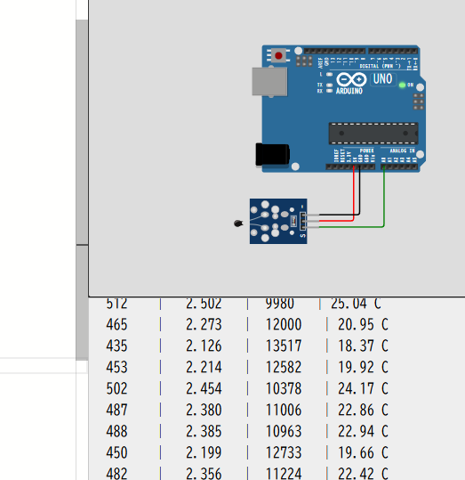

[先日のADC](https://yoshishinnze.hatenablog.com/entry/2026/11/16/043000)を実際に体感してみたいということで仮想環境の[Wokwi](https://wokwi.com/)を用いて例題を行ってみようと思います。

## 問題設定

基本はアナログ出力を行うセンサを、ADCが実装されたマイコンで読み取るということがタスクとなります。

__センサの出力形式とADCの必要性__

センサは**出力形式**によって、ADCが必要かどうかが決まります。

| センサの出力形式 | 具体例 | ADCが必要？ | 読み取り方法 |
|----------------|--------|-----------|------------|
| **アナログ電圧出力** | ポテンショメータ、TMP36、光センサ（CdS）、距離センサ（GP2Y0A） | **必要** | `analogRead()` でADC変換して読む |
| **デジタルパルス出力** | ロータリーエンコーダ、超音波距離センサ（HC-SR04 Echo） | **不要** | `digitalRead()` や `pulseIn()` で読む |
| **通信プロトコル出力** | BME280（I2C/SPI）、MPU6050（I2C）、GPSモジュール（UART） | **不要** | `Wire.h`（I2C）、`SPI.h`、`Serial` で読む |
| **PWM出力** | サーボ用角度センサ、一部距離センサ | **不要**（`pulseIn()`で対応可） | デューティ比やパルス幅を測定 |

> **アナログ電圧を出力するセンサには、マイコンがその電圧を数字として理解するためにADCが必要です。**
> 
> 一方、デジタル信号や通信プロトコルでデータを出すセンサには、ADCは不要です。

ロータリーエンコーダは「デジタルパルス出力」なのでADCは不要で、`digitalRead()` や割り込みで読み取ります。前回の例題Bでは、エンコーダを「ADCの分解能を変えるための入力デバイス」として使っていただけで、エンコーダ自体はADCを必要としない、ということになります。

## 例題1
Wokwiで試せるADCの簡単な例題を2つ用意しました。**ポテンショメータ（可変抵抗）** でADCの基本を体感する例と、**温度センサ**で実用的な計測を体験する例です。

### 問題：ポテンショメータで電圧を読む

回転ノブを動かすと電圧が変わり、ADC値（0〜1023）が変化します。ADCの分解能を視覚的に理解できます。

__使用部品__
- Arduino Uno × 1
- Potentiometer（ポテンショメータ / 可変抵抗）× 1

__配線方法__

```
ポテンショメータ
├─ 左端子 ───→ Arduino 5V
├─ 中央端子 ──→ Arduino A0（ADC入力）
└─ 右端子 ───→ Arduino GND
```

Wokwi上では、部品パレットから「Potentiometer」を選んでドラッグ&ドロップし、上記の通り配線してください。

__Arduinoコード__

```cpp
void setup() {
  Serial.begin(9600);
}

void loop() {
  int adcValue = analogRead(A0);           // 10ビットADCで読む（0〜1023）
  float voltage = adcValue * (5.0 / 1023.0); // 電圧に変換（5V基準）

  Serial.print("ADC Value: ");
  Serial.print(adcValue);
  Serial.print("  |  Voltage: ");
  Serial.print(voltage);
  Serial.println(" V");

  delay(500);
}
```

コードの解説はこんな感じです。

プログラムは大きく分けて、最初に1度だけ実行される `setup()` 関数と、電源が入っている間ずっと繰り返される `loop()` 関数の2つで構成されています。

__1. 初期設定 (`setup` 関数)__

* `Serial.begin(9600);`
* パソコンとマイコンの間で通信を行うための**シリアル通信を開始**します。通信速度（ボーレート）は `9600 bps` に設定されています。これにより、マイコン内部のデータをパソコンの「シリアルモニター」画面で確認できるようになります。


__2. メインループ (`loop` 関数)__

* `int adcValue = analogRead(A0);`
* アナログ入力ピン `A0` にかかっている電圧を読み取ります。一般的なArduino（Unoなど）のADC（アナログ・デジタル変換器）は10ビットの精度を持つため、**0 から 1023 まで**のデジタル値に変換されて `adcValue` に格納されます（例：0Vなら0、5Vなら1023付近）。


* `float voltage = adcValue * (5.0/1023.0);`
* 読み取った0〜1023の数値を、実際の**電圧値（ボルト）に変換**する計算です。基準電圧を 5.0V と仮定し、比例計算によって「何ボルトか」を浮動小数点（`float`）で求めます。


* `Serial.print(...)` / `Serial.println(...)`
* 読み取った元のADC値と、計算した電圧値を組み合わせ、次のような形式でシリアルモニターに出力します。
* 出力例：`ADC Value: 512  |  Voltage: 2.50 V`

* `delay(500);`
* 処理の間に **0.5秒（500ミリ秒）の待機時間** を入れます。これにより、データが流れる速度が人間が読み取りやすい適度な速さに調整されます。


__試し方__
1. [Wokwi](https://wokwi.com/) で新規プロジェクトを作成（Arduino Unoを選択）





2. 部品パレットから「Potentiometer」を追加



ポテンショメータには3本の端子があります。こんな感じで左から順に配線します。

```
ポテンショメータの左端子  ──→  Arduino 5V
ポテンショメータの中央端子 ──→  Arduino A0
ポテンショメータの右端子  ──→  Arduino GND
```



3. 上記コードを `sketch.ino` に貼り付け
4. シミュレーションを開始（▶ボタン）
5. **ポテンショメータのノブをドラッグして回転**させると、シリアルモニタの値が0〜1023の間で変化します



__確認ポイント__
- ノブを最小にすると `ADC Value: 0` / `Voltage: 0.00 V`
- ノブを最大にすると `ADC Value: 1023` / `Voltage: 5.00 V`
- 真ん中だと `ADC Value: 約512` / `Voltage: 約2.50 V`

これで、ポテンショメータがアナログ信号を出力し、マイコンでDC変換を行うという、 **連続的な電圧が1024段階の数字に区切られている** というADCの性質が体感できます。


## 例題2

Wokwiには「**wokwi-ntc-temperature-sensor**」という部品があり、アナログ電圧（OUTピン）を出力します。[Wokwi Docs](https://docs.wokwi.com/parts/wokwi-ntc-temperature-sensor)でも、OUTピンは「Output signal (analog)」と明記されています。

### NTC温度センサとは

NTC（Negative Temperature Coefficient / 負の温度係数）サーミスタは、**温度が上がると抵抗値が下がる**半導体センサです。

モジュール内部では、NTCと固定抵抗（10kΩ）が**分圧回路**を構成しており、温度変化に応じてOUTピンの電圧が変化します。これをADCで読み取り、電圧→抵抗→温度へと換算します。

### 問題設定

NTC温度センサを使って周囲の温度を測定し、シリアルモニタに以下を表示する。

- ADCの生値（0〜1023）
- 分圧回路の電圧（V）
- サーミスタの抵抗値（Ω）
- 換算された温度（℃）

Wokwi上でセンサをクリックすると温度スライダーが出現するので、温度を変えてADC値と計算温度がどう変化するか確認する。

### 使用部品

| 部品 | 数量 |
|------|------|
| Arduino Uno | 1 |
| NTC Temperature Sensor | 1 |

### 配線

WokwiのNTCモジュールは内部で分圧回路ができているため、**3本の線だけ**で接続できます。

```
NTC Temperature Sensor    Arduino Uno
├─ VCC  ─────────────────→  5V
├─ OUT  ─────────────────→  A0（ADC入力）
└─ GND  ─────────────────→  GND
```



### NTC温度換算の数式

NTCサーミスタの温度計算には、**Steinhart-Hart方程式の簡易版（β式）** を使います。

```
1. ADC値 → 電圧:        Vout = ADC × (5.0 / 1023)
2. 電圧 → 抵抗値:        Rntc = R_series × (Vcc / Vout - 1)
                         ※ R_series = 10kΩ, Vcc = 5V
3. 抵抗値 → 温度:        1/T = 1/T0 + (1/β) × ln(Rntc / R0)
                         ※ T0 = 25℃ = 298.15K, R0 = 10kΩ, β = 3950
4. ケルビン → 摂氏:      T(℃) = T(K) - 273.15
```

### Arduinoコード

```cpp
// NTC温度センサ（サーミスタ）を使った温度測定
// ADC値 → 電圧 → 抵抗 → 温度 の変換を体験する例題

#define NTC_PIN A0       // NTCセンサの出力をA0（ADC）で読む

// NTCサーミスタのパラメータ（10kΩ @ 25℃ の一般的なNTC）
#define R0 10000.0       // 基準抵抗 10kΩ
#define T0 298.15        // 基準温度 25℃ をケルビンに換算（25 + 273.15）
#define BETA 3950.0      // β係数（データシート参照。Wokwiデフォルトも3950）
#define R_SERIES 10000.0 // 分圧回路の直列抵抗 10kΩ
#define VCC 5.0          // 電源電圧 5V

void setup() {
  Serial.begin(9600);
  Serial.println("=== NTC Thermistor Temperature Measurement ===");
  Serial.println("ADC Raw | Voltage(V) | R_ntc(ohm) | Temp(C)");
  Serial.println("-------------------------------------------");
}

void loop() {
  // 1. ADCで読む（10ビット: 0〜1023）
  int adcValue = analogRead(NTC_PIN);

  // 2. ADC値 → 電圧に変換
  float voltage = adcValue * (VCC / 1023.0);

  // 3. 電圧 → サーミスタの抵抗値に変換
  // 分圧回路: Vout = VCC × (R_ntc / (R_series + R_ntc))
  // 変形して: R_ntc = R_series × (VCC / Vout - 1)
  float resistance;
  if (voltage < 0.001) {
    resistance = 999999.0;  // ゼロ除算回避
  } else {
    resistance = R_SERIES * ((VCC / voltage) - 1.0);
  }

  // 4. 抵抗値 → 温度（ケルビン）に変換（β式）
  // 1/T = 1/T0 + (1/β) × ln(R / R0)
  float tempKelvin = 1.0 / (
    (1.0 / T0) + 
    (1.0 / BETA) * log(resistance / R0)
  );

  // 5. ケルビン → 摂氏
  float tempCelsius = tempKelvin - 273.15;

  // シリアルモニタに表示
  Serial.print("  ");
  Serial.print(adcValue);
  Serial.print("    |   ");
  Serial.print(voltage, 3);
  Serial.print("   |  ");
  Serial.print((long)resistance);
  Serial.print("   | ");
  Serial.print(tempCelsius, 2);
  Serial.println(" C");

  delay(500);
}
```

### Wokwiでの実装手順

__Step 1: プロジェクト作成__
1. [Wokwi](https://wokwi.com/) にアクセス
2. 「**New Project**」→「**Arduino Uno**」を選択

__Step 2: 部品を追加__
1. 「**+**」ボタンをクリック
2. 検索欄に「**ntc**」と入力
3. 「**NTC Temperature Sensor**」をクリックして追加
4. Arduinoの右側にドラッグして配置

__Step 3: 配線__
```
NTC.VCC ──→ Arduino 5V
NTC.OUT ──→ Arduino A0
NTC.GND ──→ Arduino GND
```
各部品の接続点をドラッグして配線してください。

__Step 4: コードを入力__
1. コードエディタに上記コードを貼り付け
2. 「**▶ Start Simulation**」をクリック

__Step 5: 動作確認__
1. **NTCセンサ部品をクリック**すると、温度を調整するスライダーが表示されます
2. スライダーを動かして温度を変えると、シリアルモニタの値がリアルタイムで変化します



### 確認ポイント

| 温度 | ADC値（目安） | 電圧（目安） | 抵抗値（目安） |
|------|-------------|------------|--------------|
| **0℃** | 約300 | 約1.46V | 約24kΩ |
| **25℃** | 約512 | 約2.50V | 約10kΩ |
| **50℃** | 約693 | 約3.39V | 約4.1kΩ |
| **100℃** | 約905 | 約4.42V | 約680Ω |

**ポイント**: 温度が上がると抵抗値が下がり、電圧が上がり、ADC値が増加します。


## 配線観点

マイコンとセンサを配線する際に押さえるべき観点を、**電気・通信・物理・実装**の4つの軸で整理します。

### 1. 電気的な観点

__電圧レベルの一致__

マイコンとセンサの動作電圧が合っていないと、動作不良や破損の原因になります。

| マイコン | 動作電圧 | 注意点 |
|---------|---------|--------|
| Arduino Uno | 5V | 5Vセンサと直接接続可 |
| Raspberry Pi Pico | 3.3V | 5Vセンサの信号をそのまま入力すると破損リスク |
| ESP32 | 3.3V | 一部5Vトレラントピンありだが原則3.3V |
| Raspberry Pi | 3.3V | 5V入力は絶対不可 |

**対策**:
- 5Vセンサ → 3.3Vマイコン: **レベル変換回路（レベルシフター）** が必要
- 3.3Vセンサ → 5Vマイコン: 通常そのままで動作するが、電圧が低すぎてHIGH判定されない場合あり

__電源ピンの使い分け__

| ピン | 用途 | 注意 |
|------|------|------|
| **5V / 3.3V** | センサや外部回路への電源供給 | マイコンから供給できる電流には上限あり |
| **Vin** | 外部電源入力（Arduino等） | レギュレータを通してマイコンを動かす |
| **GND** | 基準電位（0V） | **必ず共有する**。GNDを繋がないと電位の基準がずれて動作しない |

**重要**: 複数の電源を使う場合（例：マイコンをUSBで、モータを別電源で）、**GNDは必ず共通に接続**してください。GNDが繋がっていないと信号電圧の基準が合わず、通信エラーや誤動作が起こります。

__電流容量の確認__

マイコンの5V/3.3Vピンから供給できる電流には限界があります。

- **Arduino Uno**: 5Vピンから約500mA（USB給電時）
- **ESP32**: 3.3Vレギュレータから約500mA

消費電流の大きいセンサ（ヒーター付きガスセンサ、GPSモジュール等）やアクチュエータ（サーボモータ、リレー）を直接マイコンから動かすと、**電圧降下でマイコンがリセット**する場合があります。

**対策**: 外部電源を使い、マイコンは信号線だけ制御する。

### 2. 通信プロトコル別の配線観点

__アナログセンサ（ADC使用）__

```
センサOUT ──→ マイコンADCピン（A0等）
センサVCC ──→ 5Vまたは3.3V
センサGND ──→ GND
```

**観点**:
- ADCピンは専用ピン（ArduinoではA0〜A5）を使う
- 入力電圧がマイコンのADC基準電圧を超えないようにする（通常5Vまたは3.3V）
- 信号線が長い場合、ノイズが乗りやすいのでフィルタ（コンデンサ）を入れる

__UART__

```
マイコンTX ──→ センサRX
マイコンRX ──→ センサTX
GND    ──────→ GND（必須）
```

**観点**:
- **TXとRXは交差させる**（送信側のTXを受信側のRXに）
- **ボーレート（通信速度）を両者で一致**させる必要がある
- フロー制御（RTS/CTS）が必要な場合もある
- 電圧レベルの不一致に注意（5V UARTと3.3V UARTはレベルシフターが必要）

__I2C__

```
SDA ────→ SDA（データ線、双方向）
SCL ────→ SCL（クロック線、マスターから）
VCC ────→ 電源
GND ────→ GND
```

**観点**:
- **プルアップ抵抗が必要**（通常マイコン内部に内蔵されているが、長配線や複数デバイスでは外部抵抗を追加）
- SDAとSCLはそれぞれ1本ずつで、**複数のデバイスを並列接続**できる
- 各デバイスには**I2Cアドレス**が割り当てられ、重複しないようにする
- 配線が長いと信号の立ち上がりが遅くなり、通信エラーが起こる

__SPI__

```
MOSI ──→ MOSI（マスター出力和スレーブ入力）
MISO ──→ MISO（マスター入力スレーブ出力）
SCK  ──→ SCK（クロック）
CS   ──→ CS（チップセレクト、デバイスごとに1本必要）
VCC  ──→ 電源
GND  ──→ GND
```

**観点**:
- **CSピンはデバイスごとに独立**に必要（1台増えるごとにGPIOが1本消費）
- I2Cより高速だが、配線本数が多い
- 配線長に注意（高速通信ほど長い配線に弱い）

__1-Wire__

```
DQ（データ）──→ GPIOピン
VCC ─────────→ 電源（パラサイトモードでは不要）
GND ─────────→ GND
```

**観点**:
- **プルアップ抵抗（4.7kΩ）が必須**
- 1本の線で複数デバイスを接続可能（各デバイスに固有IDあり）

### 3. 物理的・ノイズ対策の観点

__GNDの取り方（グラウンドループ対策）__

複数のセンサやアクチュエータを接続する場合、GNDの取り方が重要です。

- **スター接地**: 各デバイスのGNDを1点（マイコンのGND）にまとめる。最も基本的で安定
- **デイジーチェーン**: GNDを順番に繋ぐ。電流が大きいデバイス（モータ等）の影響が小さいデバイスに伝わるリスクあり

__ノイズ対策__

| 対策 | 方法 | 適用場面 |
|------|------|---------|
| **デカップリングコンデンサ** | 電源ピンの近くに0.1µFセラミックコンデンサを並列に入れる | 全てのIC・センサに推奨 |
| **シールドケーブル** | 信号線をシールドで覆う | 長距離配線、ノイズ環境 |
| **ツイストペア配線** | 信号線とGNDをツイストペアケーブルで送る | I2CやUARTの長距離配線 |
| **フィルタ回路** | 信号線にRCフィルタ（抵抗＋コンデンサ）を入れる | アナログセンサのノイズ除去 |
| **配線の分離** | 電源線（大電流）と信号線を離す | モーター等とセンサを同時使用する場合 |

__配線長の制限__

| プロトコル | 推奨最大配線長 | 理由 |
|-----------|-------------|------|
| I2C | 約1m（標準モード100kbps） | オープンドレイン＋プルアップのため立ち上がりが遅い |
| SPI | 約10cm〜30cm | 高速で配線長による信号劣化が大きい |
| UART | 約15m（低速時） | RS-232レベル変換すれば数十mも可能 |
| 1-Wire | 約30m | プルアップと配線容量に依存 |

### 4. 実装作業の観点

__ブレッドボードでの配線__

- **電源レール（＋/-）の使い方**: 縦方向のレールに5V/3.3VとGNDを分配し、各センサからそこに引く
- **ジャンパーワイヤーの色分け**: 赤（電源）、黒（GND）、黄・緑・青（信号）など色分けすると配線ミスが減る
- **配線の整理**: 信号線が電源線の上を横切るとノイズが誘導される場合がある

__ピンアサインの計画__

マイコンのピンは限られているため、事前に以下を確認します。

```
使用するピンを一覧化:
- アナログ入力: A0, A1...
- I2C: SDA, SCL（固定ピン）
- SPI: MOSI, MISO, SCK, CSxN...
- UART: TX, RX（固定ピン）
- PWM出力: ~印のあるデジタルピン
- デジタル入出力: 残りのピン
```

__データシートの確認項目__

センサを接続する前に、データシートで以下を確認してください。

- **動作電圧範囲**（VCCの最小・最大）
- **出力タイプ**（アナログ / デジタル / オープンドレイン / プッシュプル）
- **消費電流**（マイコンの電源容量を超えていないか）
- **ピン配置（Pinout）**（VCC/GND/OUTの順序）
- **推奨プルアップ/プルダウン抵抗値**

### 5. 配線前のチェックリスト

| 確認項目 | 内容 |
|---------|------|
| **電圧一致** | マイコンとセンサの動作電圧は同じか？違うならレベルシフターが必要 |
| **GND共有** | 全てのデバイスのGNDは共通に接続されているか？ |
| **ピン機能** | 使用するピンは通信やPWMなどの機能に対応しているか？ |
| **プルアップ/ダウン** | I2Cや1-Wireなど、プルアップ抵抗が必要な場合は入っているか？ |
| **電流容量** | マイコンからの電源供給で消費電流を賄えるか？ |
| **配線長** | 通信プロトコルの制限内か？ |
| **データシート** | ピン配置と電気的特性を確認したか？ |

## まとめ

> **マイコンとセンサの配線は、「電気的特性の整合」「通信プロトコルのルール」「ノイズ対策」「物理的な実装」の4つを同時に満たす作業です。**
>
> 特に **GNDの共有** と **電圧レベルの一致** は、動作不良の9割を防ぐ最重要項目です。

Wokwiなどのシミュレータでは配線ミスによる破損リスクがないため、まずは仮想環境で配線パターンに慣れてから実物に移るのが安全で効率的です。

