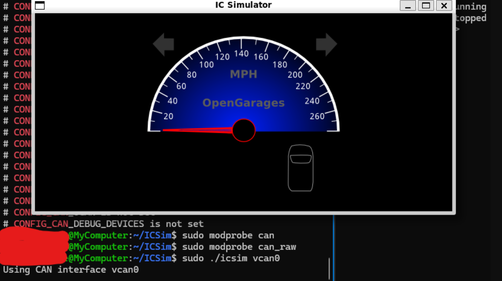
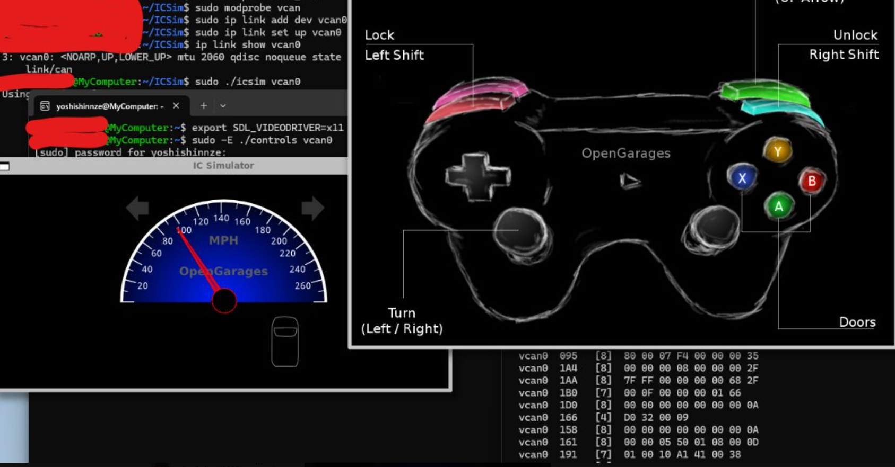

本日はWindows環境下でCAN開発の演習を行う環境構築第2段です。
前回はWSL下にCANの通信環境を提供する[vcan](https://yoshishinnze.hatenablog.com/entry/2026/10/21/043000)を導入しました。
今回は自動車の仮想シミュレータであるICSimを導入して、実際のCANによる通信を体感できるようにしていきます。

## ICSimとは

ICSim（Instrument Cluster Simulator）は、**自動車の計器盤（メーターパネル）とその操作をシミュレートするオープンソースの学習ツール**です。

### 名前の意味

- **I**nstrument **C**luster **Sim**ulator
- 「Instrument Cluster」とは、運転席の前にある**スピードメーター・タコメーター・燃料計などが並んだ計器盤**のことです。

### どんなものか

ICSim は **Linux 上で動作する 2 つの画面**から構成されています。

| プログラム | 役割 |
|------------|------|
| `icsim` | **計器盤の表示**。vcan0 上の CAN メッセージを受け取り、スピードメーターやウインカー、ドアロックのランプなどを動かします。 |
| `controls` | **コントローラー**。キーボード操作を CAN メッセージに変換して vcan0 に送信します。 |

つまり、**コントローラーで「アクセルを踏む」と、それに対応する CAN メッセージが vcan0 に流れ、計器盤のスピードメーターの針が動く**、という仕組みです。

### 何ができるのか

実際の車では計器盤の中身はブラックボックスですが、ICSim では **CAN バス（vcan0）上のメッセージがすべて見える**ため、以下のような学習ができます。

- **CAN メッセージの観測**：`candump` や `cansniffer` で、どの操作がどの CAN ID・データに対応するか調べる
- **メッセージの特定**：「左ウインカーを出すと ID `188` に `01` が入る」などの対応関係を解析する
- **リプレイ攻撃**：記録したメッセージを `canplayer` で再生し、同じ動作を再現する
- **なりすまし攻撃**：`cansend` や Python スクリプトで偽の CAN メッセージを送信し、計器盤を意図的に動かす
- **DoS 攻撃の体験**：大量の CAN メッセージを流してシステムにどう影響するか確認する


### なぜ便利なのか

実際の自動車を用意しなくても、**1 台の PC（Linux）だけで「車載ネットワークのセキュリティ演習」ができる**点が最大の魅力です。

- 実車がなくても CAN プロトコルの挙動を体験できる
- 間違えて壊しても大丈夫（仮想環境なので）
- パケットの内容がすべて見えるため、解析の練習に最適

## 環境構築

以下に、Windows + WSL2 環境で vcan 対応カーネルを使い、ICSim を構築してメーターを表示するまでの流れをまとめます。

### WSL2 + vcan カーネルで ICSim 環境を構築しメーターを表示するまで

__1. 前提条件__

- Windows 上に **WSL2（Windows Subsystem for Linux 2）** と **Ubuntu** がインストール済み
- WSL2 は独自の Linux カーネルを使用するため、**Microsoft のデフォルトカーネルでは CAN 機能が無効**になっている
- WSL2上にvcanの環境が構築されている(環境構築の手順は[こちら](https://yoshishinnze.hatenablog.com/entry/2026/10/21/043000)をご参考頂ければと思います。)

__2. 問題①：デフォルト WSL2 カーネルは CAN（vcan）に非対応__

導入時にコケる問題でコマンドに `modprobe vcan` を打ってもエラーになることがあります。

**不具合の内容：**
WSL2 のデフォルトカーネルには SocketCAN や vcan（Virtual CAN）のモジュールが含まれていないため、`modprobe vcan` が失敗し、仮想 CAN バスを作成できない。

**解決策：**
**CAN 機能を有効化したカスタムカーネル**に差し替える。

- カーネルを自分でビルドするか、コミュニティが配布している **プリビルドカーネル（bzImage）** を利用する
- Windows ユーザーホームディレクトリに `.wslconfig` ファイルを作成し、カーネルパスを指定して WSL2 を再起動

__3. vcan0（仮想 CAN バス）の作成__

カーネル差し替え後、以下のコマンドで vcan0 を作成・有効化する。

```bash
sudo modprobe vcan
sudo ip link add dev vcan0 type vcan
sudo ip link set up vcan0
ip link show vcan0
```

**各コマンドの意味：**
| コマンド | 役割 |
|----------|------|
| `modprobe vcan` | カーネルに vcan 機能を読み込む |
| `ip link add dev vcan0 type vcan` | vcan0 という仮想 CAN インターフェースを作成 |
| `ip link set up vcan0` | vcan0 を通信可能な状態（UP）にする |
| `ip link show vcan0` | vcan0 の状態を確認 |

**確認ポイント：** `ip link show vcan0` の出力に `<NOARP,UP,LOWER_UP>` と含まれていれば成功。

__4. ICSim のインストールとビルド__

```bash
sudo apt update
sudo apt install -y libsdl2-dev libsdl2-image-dev can-utils git make gcc
git clone https://github.com/zombieCraig/ICSim.git
cd ICSim
make
```

__5. 問題②：`./icsim vcan0` 実行時に `Couldn't create raw socket` エラー__

**不具合の内容：**
ビルド後、`./icsim vcan0` を実行すると以下のエラーが発生。

```
Couldn't create raw socket
Usage: icsim [options] <can>
```

**試行した解決策と結果：**
- `sudo ./icsim vcan0` で実行しても同じエラーが継続

**原因の切り分け：**
- `wsl -l -v` で確認したところ **VERSION は 2（WSL2）** だったため、WSL1 ではない
- `zcat /proc/config.gz | grep CONFIG_CAN` でカーネル設定を確認したところ、CAN 関連機能は `=m`（モジュール）として有効化されていた

```
CONFIG_CAN=m
CONFIG_CAN_RAW=m
CONFIG_CAN_BCM=m
CONFIG_CAN_DEV=m
CONFIG_CAN_VCAN=m
```

**根本的な原因：**
`vcan` モジュールは `modprobe vcan` で読み込まれていたが、**CAN ソケット通信に必要な `can` 本体と `can_raw` モジュールが自動読み込みされず、不足していた**。

__6. 解決策：必要な CAN モジュールを明示的に読み込む__

以下のコマンドを実行し、不足していたモジュールを手動で読み込む。

```bash
sudo modprobe can
sudo modprobe can_raw
```

**モジュールの役割：**
| モジュール | 役割 |
|------------|------|
| `vcan` | 仮想 CAN デバイス（vcan0）を作成する |
| `can` | CAN プロトコルファミリー（PF_CAN）を提供する |
| `can_raw` | Raw CAN ソケット（SOCK_RAW）を提供する |

読み込み確認：
```bash
lsmod | grep can
```

以下のように表示されれば OK。
```
vcan                   16384  0
can_raw                20480  0
can                    36864  1 can_raw
```

__7. ICSim の起動__

モジュール読み込み後、以下のコマンドで ICSim を起動。

```bash
sudo ./icsim vcan0
```

結果：メーター（計器盤）のウィンドウが正常に表示されればICSimの環境構築完了です。



### 全体の流れまとめ

```
Windows + WSL2
    ↓
デフォルトカーネル → CAN 非対応 ❌
    ↓
カスタムカーネル（CAN モジュール有効）に差し替え
    ↓
vcan0 を作成・有効化（modprobe vcan + ip link add/set up）
    ↓
ICSim を clone & make でビルド
    ↓
実行 → Couldn't create raw socket ❌
    ↓
原因：can / can_raw モジュールが未読み込み
    ↓
sudo modprobe can / sudo modprobe can_raw で解決
    ↓
sudo ./icsim vcan0 → メーター表示 ✅
```


### 今後の演習の進め方

メーターが表示されたら、別ターミナルで以下を実行することで CAN 通信の例題を始められます。

```bash
# コントローラー（操作盤）の起動
sudo ./controls vcan0

# CAN メッセージの観測
candump vcan0
```

これで、キーボード操作に対応する CAN メッセージの流れをリアルタイムで確認できます。

## 少しお試し

早速導入した ICSim を使った CAN 通信の体験をしてみます。  
別々のターミナルを 3 つ開くか、`tmux` で画面を分割して同時に確認すると効果的です。

### 準備

まず `tmux` が入っていなければインストールしておくと便利です。

```bash
sudo apt install -y tmux can-utils
```

vcan0 が有効になっていることを確認します。

```bash
ip link show vcan0 | grep UP
```

`UP` と表示されれば OK です。

### ステップ 1：ICSim 計器盤を起動する

**ターミナル 1** で実行します。

```bash
cd ~/ICSim
sudo ./icsim vcan0
```

車のメーターパネル（スピードメーター・ウインカー・ドアロックのランプなど）が表示されたら成功です。

### ステップ 2：コントローラーを起動する

**ターミナル 2** で実行します。

```bash
cd ~/ICSim
sudo ./controls vcan0
```

操作盤のウィンドウが表示されます。**このウィンドウをクリックしてアクティブにした状態で**、以下のキーを押します。

| 操作 | キー |
|------|------|
| 左ウインカー | `←`（左カーソル） |
| 右ウインカー | `→`（右カーソル） |
| アクセル | `↑`（上カーソル） |
| 全ドアロック解除 | `Left Shift` + `Right Shift` |

### ステップ 3：CAN メッセージを観測する

**ターミナル 3** で実行します。

```bash
candump vcan0
```

この状態で **ターミナル 2（controls）** に戻り、`←` や `↑` を押してみてください。  
ターミナル 3 に以下のようなメッセージが流れ始めます。

```
  vcan0  188   [1]  01
  vcan0  188   [1]  00
  vcan0  244   [8]  00 00 00 00 00 00 00 00
```

これが **CAN 通信の生のデータ**です。

- `vcan0`：通信が流れたバス名
- `188` / `244`：CAN ID（どの機器・操作に対応するかの識別子）
- `[1]` / `[8]`：データ長（バイト数）
- `01` / `00 ...`：実際のデータ（ペイロード）

### ステップ 4：変化するメッセージだけを抽出する

`candump` ではメッセージが多すぎて見づらいため、**変化したメッセージだけをハイライト表示**する `cansniffer` を使います。

ターミナル 3 で `Ctrl + C` で `candump` を止め、以下を実行します。

```bash
cansniffer -c vcan0
```

`-c` は変化したバイトの色を変えるオプションです。

この状態で controls に戻り、**`←`（左ウインカー）を押してすぐ離す**と、特定の CAN ID の特定のバイトだけが赤く変化します。  
これが「**左ウインカーに対応する CAN メッセージ**」です。

同様に `→` や `↑` を試し、どの ID・どのバイトがどの操作に対応するか観察してみてください。

こんな感じで画面右下の画面にデータが出力されるようになります。
これがcanで送信されているメッセージです。



## 受信したデータ

お試しで出したメッセージについて説明します。

### 出力の構造

各データの1行が **1 つの CAN メッセージ（1 フレーム）** に対応します。

```
vcan0  244   [5]  00 00 00 01 AC
│      │     │    └─ データ（ペイロード）：16 進数で 1 バイトずつ表示
│      │     └────── データ長（DLC）：このメッセージは 5 バイト
│      └─────────── CAN ID：メッセージの種類を示す識別子（16 進数）
└────────────────── インターフェース：vcan0（仮想 CAN バス）
```

### 各フィールドの意味

__CAN ID（例：`244`, `095`, `17C` など）__
- **どの機器や機能に関するメッセージか**を示す識別子です。
- CAN プロトコルでは「送信先アドレス」ではなく「**メッセージの種類**」を表します。バス上の全 ECU がこの ID を見て、自分に関係あるメッセージだけを受け取ります。
- ICSim では、ウインカー、アクセル、ドアロックなど、それぞれ異なる CAN ID が割り当てられています。

__DLC（例：`[5]`, `[4]`, `[8]`）__
- **Data Length Code** の略で、ペイロードのバイト数（0～8）を示します。
- 例えば `[8]` ならデータ部は 8 バイト、`[4]` なら 4 バイトです。

__データ（例：`00 00 00 01 AC`）__
- **実際に送られている値**です。スイッチの ON/OFF、速度、温度、舵角などの情報がここに入ります。
- 1 つのメッセージに複数の情報が詰め込まれていることもあります。

### このメッセージ群は何をしているのか

ICSim の環境では、これらのメッセージは **「車の各種状態を表す信号」** として vcan0 上に流れています。

例えば、以下のようなイメージです。

| CAN ID | 想定される役割（ICSim 内の一例） |
|--------|----------------------------------|
| `244` | スロットル（アクセル）関連 |
| `095` | 車速や計器表示関連 |
| `17C` | ライト・ウインカー・警告灯の状態 |
| `158`, `161` など | その他の計器やセンサー情報 |

ただし、**ICSim では起動時のシード値によって CAN ID とデータの対応関係が変わることがあります。** そのため「この ID は必ずウインカー」という固定の解説ではなく、**`cansniffer` などで変化を観察しながら自分で特定する**のが演習の基本になります。

## 総括

今回の記事の内容を簡潔に総括します。


**概要：** WSL2 上の vcan 環境に、車載ネットワーク学習ツール「ICSim」を導入し、CAN 通信の観測・解析を体験する。

**ICSim とは：** 自動車の計器盤（`icsim`）とコントローラー（`controls`）の 2 画面からなるシミュレータ。キーボード操作を CAN メッセージに変換し、計器盤に反映する仕組み。

**構築の流れと障害：**
- WSL2 のデフォルトカーネルは CAN 非対応のため、**CAN 対応カスタムカーネル**への差し替えが必要
- `vcan0` を作成・有効化（`modprobe vcan` → `ip link add/set up`）
- ICSim を clone し `make` でビルド
- 実行時に `Couldn't create raw socket` エラーが発生 → 原因は **`can` / `can_raw` カーネルモジュールが未読み込み** → `sudo modprobe can can_raw` で解決
- `sudo ./icsim vcan0` で計器盤表示成功

**演習内容：**
- `controls` で操作（方向キー等）し、`candump vcan0` で生の CAN メッセージを観測
- `cansniffer -c vcan0` で変化したバイトをハイライト表示し、操作と CAN ID の対応関係を特定

**CAN メッセージの構造：**
- **CAN ID**（例：`244`）：メッセージの種類を示す識別子
- **DLC**（例：`[5]`）：データ長（バイト数）
- **データ**（例：`00 00 00 01 AC`）：実際の状態値（ペイロード）

**結論：** WSL2 + カスタムカーネル + vcan0 + ICSim で、実車なしに CAN 通信のキャプチャ・解析・攻撃体験が可能になった。

