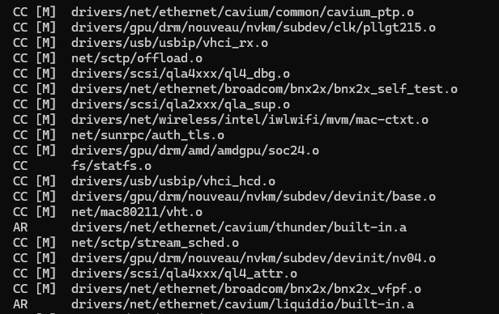
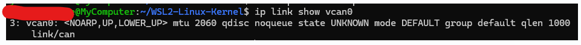
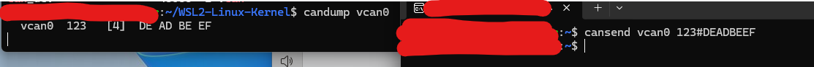

ロボットの制御を扱う制御屋さんは[CAN](https://yoshishinnze.hatenablog.com/entry/2026/10/18/043000)を使う機会が非常に多くなります。

そして日本のエンジニアの多くは基本Windowsを持っていることが多いです。
ですのでWindows上でCANのシミュレーションができる環境が欲しいと思いました。

本日はWindows上でCANのシミュレーションを行うVirtual CAN(以下 `vcan` と呼びます)の導入について説明していきます。

## vcanとは

**vcan（Virtual CAN）** は、物理的なCANハードウェアなしに、ソフトウェアだけでCANバスを再現するLinuxカーネルの仮想デバイスです。

### 要点

- **CANバスをメモリ上でエミュレート**するため、CANインターフェースカードが不要です
- **SocketCAN** と連携し、`cansend` や `candump` などの標準ツールがそのまま使えます
- 複数のvcanインターフェース（`vcan0`, `vcan1` など）を作成でき、**複数バスの通信シミュレーション**も可能です
- 物理層（ビットレート、ノイズなど）の制約がないため、アプリケーションレイヤーの開発・テストに最適です

### 1コマンドで作成

```bash
sudo ip link add dev vcan0 type vcan
sudo ip link set up vcan0
```

これだけで、実機と同じようにCANフレームの送受信ができます。

## vcanで出来ること

WSL2上で構築したvcan環境では、**物理的なCANデバイスなしに、CAN通信の全てをソフトウェア上で再現**できます。

### 1. CANフレームの送受信

`can-utils` を使って、実際のCANバスと同じコマンドで通信できます。

```bash
# ターミナル1: 受信モニタ
candump vcan0

# ターミナル2: フレーム送信
cansend vcan0 123#1122334455667788
```

`candump` にリアルタイムでフレームが表示されます。これは実機のCANインターフェースと全く同じ操作感です。

### 2. CANログの再生・解析

実車でキャプチャしたCANログ（.asc, .log, .csvなど）を `canplayer` で再生できます。

```bash
# 保存したログをvcan0に再生
canplayer -I drive_log.log

# 別ターミナルで受信確認
candump vcan0
```

車載ネットワークの通信パターンを、実車なしで解析・学習できます。

### 3. PythonでCANアプリケーションの開発

`python-can` を使って、自分でCAN送受信プログラムを書けます。

```python
import can

bus = can.interface.Bus(channel='vcan0', bustype='socketcan')

# 送信
msg = can.Message(arbitration_id=0x123, data=[0x11, 0x22, 0x33])
bus.send(msg)

# 受信
received = bus.recv(timeout=1.0)
print(received)
```

このコードは、後に実機のCANインターフェース（SocketCAN対応USBデバイスなど）に差し替えるだけで、そのまま動作します。

### 4. ECUシミュレータの自作

PythonやCで、複数のECUをシミュレートするプログラムを書けます。例えば：

- エンジンRPMを定期的に送信するECU
- アクセル開度に応じてスロットル信号を返すECU
- 診断リクエストに応答するECU

これらを同時に動かして、仮想CANバス上で複数ECUの通信を再現できます。

### 5. DBCファイルのパース・デコード

車載CANでは、生のフレーム（CAN-ID + 8バイトデータ）を物理量（速度、回転数、温度など）に変換するためにDBCファイル（データベース）を使います。

```python
import cantools

db = cantools.database.load_file('vehicle.dbc')
msg = db.get_message_by_name('EngineData')
print(msg.signals)  # RPM, Temperature などの信号情報
```

vcan上でフレームを受信し、DBCでデコードする一連の流れを練習できます。

### 6. UDS診断通信のシミュレーション

UDS（Unified Diagnostic Services）は、車の診断用プロトコルです。vcan上で以下ができます：

- 診断リクエストの送信（例: 故障コードの読み出し）
- 診断サーバ（ECU側）のシミュレーション
- ISO-TP（マルチフレーム通信）の練習

### 7. ICSimなどの既存シミュレータを動かす

ICSim（Instrument Cluster Simulator）は、CANフレームを受信してメーターパネルのGUIを動かすシミュレータです。vcan上で動作し、カーハッキングの学習に広く使われています。


### 実機との違い

| 項目 | vcan | 実機 |
|------|------|------|
| 物理層 | ソフトウェア（メモリ上） | CANトランシーバ + バス線 |
| ビットレート | 不要（無限速） | 125Kbps, 500Kbpsなど |
| ノイズ | なし | 実環境のノイズあり |
| 複数ホスト | 同一マシン内のみ | ネットワーク越しも可能 |

vcanはアプリケーションレイヤーの開発・テストには十分ですが、物理層のノイズ耐性やタイミングの検証には実機が必要です。

## 環境構築

ここまでの流れを、**何をしたのか**と**なぜやったのか**を含めて整理します。

### 全体の流れ

WSL2のデフォルトカーネルには **SocketCAN（vcan）が含まれていない** ため、自分でカーネルをビルドして差し替える必要がありました。

```
問題発生
  ↓
カーネルソースを取得
  ↓
設定ファイル（.config）を準備
  ↓
CAN/vcan関連の設定を追加
  ↓
依存関係を解決（make oldconfig）
  ↓
カーネルをビルド（make）
  ↓
生成されたカーネルをWindows側に配置
  ↓
WSL2にカスタムカーネルを指定して再起動
  ↓
vcanが使えることを確認
```

### ステップごとの解説

__ステップ1: 問題の確認__

```bash
sudo modprobe vcan
```

**エラー**: `Module vcan not found`

**理由**: WSL2のデフォルトカーネルにSocketCANモジュールがコンパイルされていなかったため。

__ステップ2: カーネルソースの取得__

```bash
cd ~
git clone https://github.com/microsoft/WSL2-Linux-Kernel.git
cd WSL2-Linux-Kernel
```

**理由**: カーネルの設定を変更して再ビルドするには、ソースコードが必要です。

__ステップ3: 現在のカーネル設定をコピー__

```bash
cp /proc/config.gz .
gunzip config.gz
mv config .config
```

**理由**: 現在動作しているカーネルの設定をベースにすることで、既存の機能を壊さずに必要な項目だけ追加できます。

**トラブル**: `.config` がディレクトリになってしまった場合は、一度削除またはリネームしてから再度コピーしました。

__ステップ4: CAN/vcan関連の設定を追加__

```bash
chmod +w .config

echo "CONFIG_NETDEVICES=y" >> .config
echo "CONFIG_CAN=m" >> .config
echo "CONFIG_CAN_RAW=m" >> .config
echo "CONFIG_CAN_BCM=m" >> .config
echo "CONFIG_CAN_GW=m" >> .config
echo "CONFIG_CAN_VCAN=m" >> .config
echo "CONFIG_CAN_SLCAN=m" >> .config
```

**理由**: `make menuconfig` で手動で探しても `Network device support` が見つからなかったため、設定ファイルに直接追記しました。

**各設定の意味**:

| 設定 | 意味 |
|------|------|
| `CONFIG_NETDEVICES=y` | ネットワークデバイスサポートを有効化 |
| `CONFIG_CAN=m` | CANバスサブシステムをモジュールとしてビルド |
| `CONFIG_CAN_VCAN=m` | 仮想CANインターフェース（vcan）をモジュールとしてビルド |
| `CONFIG_CAN_SLCAN=m` | SLCANプロトコルをモジュールとしてビルド |

__ステップ5: 依存関係の自動解決__

```bash
make oldconfig
```

**理由**: 新しく追加した設定が、他の設定と矛盾しないかを自動的にチェック・修正します。質問が表示されたら、基本的に **Enter**（デフォルト値）で進めます。

__ステップ6: 設定の確認__

```bash
grep -E "CONFIG_NETDEVICES|CONFIG_CAN" .config
```

**確認すべき結果**:

```
CONFIG_NETDEVICES=y
CONFIG_CAN=m
CONFIG_CAN_RAW=m
CONFIG_CAN_VCAN=m
CONFIG_CAN_SLCAN=m
CONFIG_CAN_DEV=m
```

これらが表示されれば、CAN関連の設定が正しく反映されています。

__ステップ7: カーネルのビルド__

```bash
make -j$(nproc)
```

**理由**: ソースコードから実際のカーネルイメージ（`bzImage`）を生成します。`$(nproc)` はCPUコア数を自動検出して並列ビルドするため、時間を短縮できます。

**所要時間**: 10分〜30分程度



__ステップ8: カーネルイメージをWindows側にコピー__

```bash
cp arch/x86/boot/bzImage /mnt/c/Users/$USER/bzImage
```

**理由**: WSL2はWindows側の設定ファイル（`.wslconfig`）からカーネルパスを読み取るため、Windowsのファイルシステム上に配置する必要があります。

__ステップ9: WSL2にカスタムカーネルを指定__

Windows側で `%USERPROFILE%\.wslconfig` を作成・編集します。

```ini
[wsl2]
kernel=C:\\Users\\<ユーザー名>\\bzImage
```

**理由**: WSL2が起動時に、デフォルトカーネルではなく、このカスタムカーネルを読み込むように指示します。

__ステップ10: WSL2を再起動__

```powershell
wsl --shutdown
```

その後、WSL2に再度入ります。

```bash
uname -r
```

こんな感じでカスタムカーネルのversionが表示されればカスタムカーネルが読み込まれています。


__ステップ11: vcanの動作確認__

```bash
sudo modprobe vcan
sudo ip link add dev vcan0 type vcan
sudo ip link set up vcan0
ip link show vcan0
```

**成功の確認**: `vcan0` の情報が表示されればOKです。



### 全体手順

全体手順はこんな感じとなります。

| ステップ | やったこと | 目的 |
|---------|-----------|------|
| 1 | vcanのロードを試す | 問題を確認 |
| 2 | カーネルソースを取得 | ビルドの準備 |
| 3 | `.config` をコピー | 現在の設定をベースにする |
| 4 | CAN設定を追加 | vcanを有効化する |
| 5 | `make oldconfig` | 依存関係を解決 |
| 6 | `grep` で確認 | 設定が反映されたか確認 |
| 7 | `make -j$(nproc)` | カーネルをビルド |
| 8 | `bzImage` をWindowsにコピー | WSL2から参照できるようにする |
| 9 | `.wslconfig` を作成 | カスタムカーネルを指定 |
| 10 | `wsl --shutdown` | 再起動して設定を反映 |
| 11 | vcanの動作確認 | 成功したか確認 |

## 例題

vcan0 が正常に動作していれば環境構築できています。
以下に、CAN通信を体感できる簡単な例題を3つ示します。


### 例題1: 基本的な送受信

__ターミナル1（受信側）__
```bash
candump vcan0
```

__ターミナル2（送信側）__
```bash
cansend vcan0 123#DEADBEEF
```

**確認ポイント**: ターミナル1に以下のように表示されれば成功です。



`123` はCAN-ID（16進数）、`[4]` はデータ長（4バイト）、その後がデータです。

### 例題2: 連続送信とフィルタ

__ターミナル1（特定IDのみ受信）__
```bash
candump vcan0,123:7FF
```

`123:7FF` は「CAN-ID `0x123` のみ受信」というフィルタです。

__ターミナル2（異なるIDで送信）__
```bash
cansend vcan0 123#11
cansend vcan0 456#22
cansend vcan0 123#33
```

**確認ポイント**: `0x123` のフレームのみ表示され、`0x456` は無視されます。

### 例題3: Pythonで送受信

```python
import can
import threading
import time

# 受信側
bus_rx = can.interface.Bus(channel='vcan0', bustype='socketcan')

def receive():
    msg = bus_rx.recv(timeout=5)
    if msg:
        print(f"受信: ID=0x{msg.arbitration_id:03X}, Data={msg.data.hex()}")

threading.Thread(target=receive).start()

# 送信側（別スレッドで少し待って送信）
bus_tx = can.interface.Bus(channel='vcan0', bustype='socketcan')
time.sleep(0.5)
msg = can.Message(arbitration_id=0x123, data=[0x11, 0x22, 0x33, 0x44])
bus_tx.send(msg)
print("送信完了")
```

**実行方法**:
```bash
pip install python-can
python3 can_test.py
```

**確認ポイント**:
```
送信完了
受信: ID=0x123, Data=11223344
```

## 総括

ということでwindows上でCAN通信を行う環境を構築しました。
次回以降CANを使った例題を扱っていきます。

