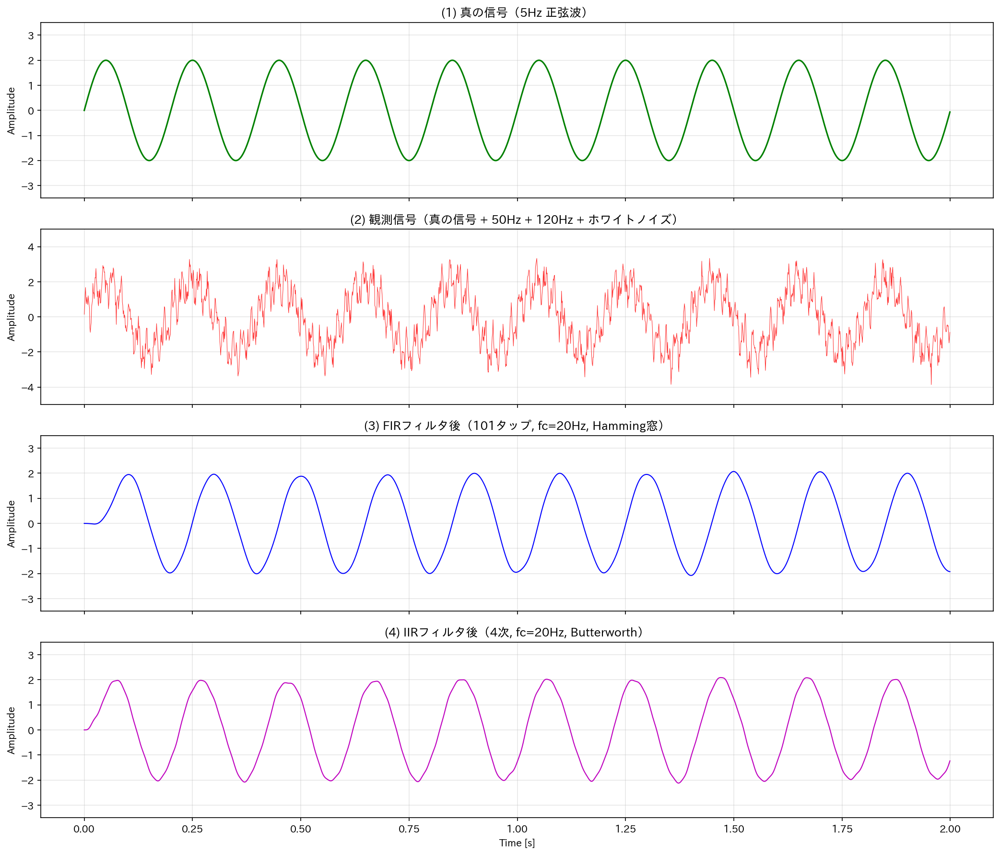
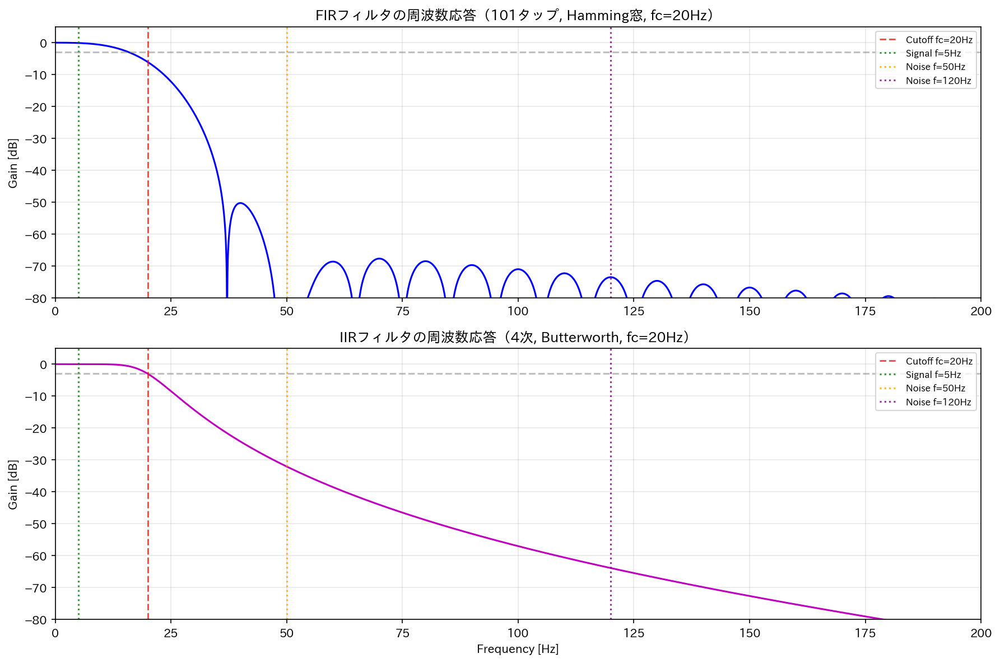
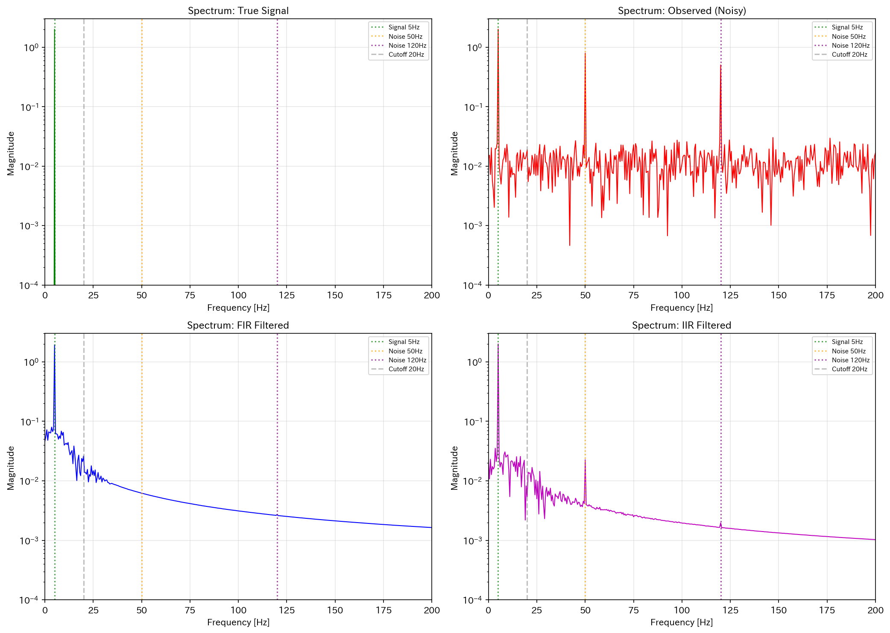

## フィルタとは
フィルタは、センサから得られた信号の中から **「本当に知りたい変化」だけを残し、「不要なノイズ（揺らぎ）」を取り除くための装置・回路・計算処理**です。

### 1. 直感的なアナロジー：味噌汁の「こし」

味噌汁を鍋から椀に注ぐとき、だしこしや味噌の粒が入らないように「こし器」を使います。

- **味噌汁全体**: 生のセンサ信号（本当の温度＋ノイズ＋ドリフト）
- **こし器**: フィルタ
- **椀に入る透明な汁**: ノイズを除去した「信頼できる測定値」
- **こし器に残る粒**: 除去されたノイズ

センサの生データは、測りたい物理量の情報と、電気的な揺らぎ・環境ノイズ・機械的な振動などが混ざった「にごった汁」のようなものです。フィルタはそれを「こして」澄ます作業です。

### 2. なぜノイズが入るのか

センサ信号にノイズが乗る主な原因は以下の通りです。

- **電気的ノイズ**: 電源の揺らぎ、周囲の機器からの電磁波
- **量子化誤差**: ADCで電圧を数字に変換する際の丸め誤差
- **機械的振動**: 加速度センサや圧力センサに不要な振動が乗る
- **温度ドリフト**: 回路自体が温まることで特性が変化する

このノイズをそのまま使うと、**「温度が実際には変わっていないのに値がガタガタする」**、あるいは **「急な変化を見逃す」** といった問題が起こります。

### 3. フィルタの種類と役割

__ローパスフィルタ（Low-Pass Filter / LPF）__

**ゆっくり変化する信号だけを通し、急激な変化（高周波ノイズ）を遮ります。**

例: 温度センサの値が0.1秒ごとにランダムに±0.5度揺れる → LPFで滑らかな温度変化だけを抽出

__ハイパスフィルタ（High-Pass Filter / HPF）__

**急に変化する信号だけを通し、ゆっくりした変化（ドリフトやオフセット）を除去します。**

例: 加速度センサに時間経過で増えていく温度ドリフトが乗る → HPFでドリフト成分を除去し、振動成分だけを抽出

__移動平均フィルタ（Moving Average）__

**直近の複数の測定値を平均化して、ランダムなノイズを打ち消します。**

例: 直近5個のADC値を平均する。ノイズはプラスとマイナスが打ち消し合い、真値に近づく

### 4. フィルタの限界・注意点

フィルタは「万能のノイズ除去剤」ではありません。

__① 必要な信号も一緒に削ることがある__

LPFを強くかけすぎると、**本当に急いで変化している温度**まで滑らかにされて、変化のタイミングが遅れて見えます。

__② フィルタの種類を間違えると逆効果__

温度のドリフトを除去したいのにHPFを使うと、**定常的な温度値そのものが消えてしまいます**。何を取り除きたいノイズなのかを把握してから選ぶ必要があります。

__③ フィルタは「情報を作る」ものではない__

ノイズに埋もれた微小な信号をフィルタで「見えやすく」はできますが、**元のデータに全く含まれていない情報は生み出せません**。

### 一言で言うと

フィルタは、センサ信号に混じった不要な成分（ノイズ・ドリフト・揺らぎ）を取り除き、「本当に知りたい物理量の変化」だけを抽出するための信号処理です。LPF・HPF・移動平均など、取り除きたいノイズの性質に応じて使い分けます。

## フィルタの種類

フィルタは、**「どの速さ（周波数）の変化を通して、どの速さの変化を遮るか」** で分類されます。

### 1. 基本概念

センサ信号の変化には「速さ」があります。

- **ゆっくり変化**: 室温の変化、体重の変化、バッテリーの電圧低下
- **中程度の変化**: 人間の歩行の加速度、機械の振動
- **急激な変化**: 電気ノイズ、スイッチのチャタリング、通信干渉

フィルタはこの「速さ」の境界を決めて、**通したい変化だけを残す**仕組みです。

### 2. 直感的なアナロジー：ふるい

| フィルタ | ふるいのイメージ | 通すもの | 遮るもの |
|---------|----------------|---------|---------|
| **ローパス** | 細かい目のふるい | 大きな粒子（ゆっくり変化） | 小さな粒子（急激な変化） |
| **ハイパス** | 粗い目のふるい | 小さな粒子（急激な変化） | 大きな粒子（ゆっくり変化） |
| **バンドパス** | 特定の大きさだけ通すふるい | 決まった大きさの粒子だけ | それ以外全部 |
| **バンドストップ** | 特定の大きさだけ引っかけるふるい | 決まった大きさ以外全部 | 特定の大きさの粒子だけ |

### 3. フィルタの種類

__ローパスフィルタ（LPF / Low-Pass Filter）__

**ゆっくり変化する信号を通し、急激な変化（高周波ノイズ）を遮ります。**

- 用途例: 温度センサのノイズ除去、ジャイロのドリフト補正
- センサ例: TMP36の値がランダムにガタガタ揺れる → LPFで滑らかに
- コード例（移動平均）:
  ```cpp
  float filtered = 0.9 * prevValue + 0.1 * newValue;  // 直前値を90%＋新値を10%
  ```

__ハイパスフィルタ（HPF / High-Pass Filter）__

**急激な変化を通し、ゆっくりした変化（ドリフト・オフセット）を遮ります。**

- 用途例: 加速度センサから重力（DC成分）を除去して振動だけを取り出す
- センサ例: MPU6050の加速度から、重力の影響を除いて動的加速度だけを抽出
- 注意: 定常値（温度の絶対値など）も消えるので、使い方を間違えると情報が失われる

__バンドパスフィルタ（BPF / Band-Pass Filter）__

**特定の周波数帯域だけを通し、それより低い・高い周波数を両方遮ります。**

- 用途例: 心電図（ECG）で心拍の周波数帯域（0.5〜40Hz）だけを抽出
- センサ例: 振動センサで、回転機械の特定の回転数に対応する振動だけを取り出す
- 応用: 音声認識、生体信号処理

__バンドストップフィルタ（BSF / Band-Stop Filter）/ ノッチフィルタ__

**特定の周波数だけを遮り、それ以外は通します。「ノッチフィルタ」とも呼ばれます。**

- 用途例: 電源の50Hz/60Hz商用電源ノイズ（ハムノイズ）を除去
- センサ例: 生体信号計測で、電源周波数が信号に乗るのを除去
- 特徴: 特定の「敵」だけを精密に除去できる

__オールパスフィルタ（All-Pass Filter）__

**すべての周波数を通しますが、位相（タイミング）だけをずらします。**

- 用途例: 信号のタイミング調整、位相補正
- センサ例: 複数センサの信号を時間的に揃える処理

### 4. 実装方法による分類

同じ「ローパスフィルタ」でも、作り方は2種類あります。

__アナログフィルタ（回路で実現）__

抵抗（R）とコンデンサ（C）だけで作れる**RCフィルタ**が代表的です。

```
【RCローパスフィルタ】
入力 ──[R]──┬── 出力
            │
           [C]
            │
           GND
```

- カットオフ周波数 fc = 1 / (2πRC)
- センサの直後に入れて、ノイズをADC変換前に除去する

__デジタルフィルタ（ソフトウェアで実現）__

ADC変換後の数字に対して計算処理を行います。

| デジタルフィルタ | 特徴 |
|----------------|------|
| **移動平均** | 直近N個を平均。シンプルだが遅延が生じる |
| **指数平滑** | 前回値と新値を重み付け。メモリ効率が良い |
| **FIRフィルタ** | 有限インパルス応答。安定で位相特性が良い |
| **IIRフィルタ** | 無限インパルス応答。FIRより少ない次数で鋭い特性 |

### 5. センサ用途別のフィルタ使い分け

| センサ・用途 | おすすめフィルタ | 理由 |
|------------|--------------|------|
| **温度センサ** | LPF（移動平均 or 指数平滑） | 温度はゆっくり変化するので、急激なノイズを除去 |
| **加速度センサ（姿勢推定）** | LPF（重力成分）＋HPF（動的加速度） | 重力と動的加速度を分離 |
| **心電図・脈波** | BPF（0.5〜40Hz） | 心拍成分だけを抽出 |
| **電源ノイズ除去** | ノッチフィルタ（50/60Hz） | 商用電源周波数だけを精密に除去 |
| **超音波距離センサ** | medianフィルタ（中央値） | スパイクノイズ（外れ値）を除去 |

### 6. 補足：移動平均は本当に「フィルタ」なのか

移動平均は直感的で使いやすいですが、**周波数特性があまり鋭くありません**。急に遮る境界がぼやけていて、ノイズと本物の信号の区別が曖昧になりやすいです。

より高性能なフィルタ（バターワース、チェビシェフ、ガウシアンなど）は、**遮る周波数と通す周波数の境界を鋭く**できます。ただし、計算量が増えたり、信号に遅延（位相遅れ）が生じたりします。

## 実験
実際にフィルタをPythonで動作させてみます。

### 実験の設定

**真の信号**: 5Hz の正弦波（振幅2.0）

**ノイズ**:
- 50Hz の高周波ノイズ（電源ノイズを模倣）
- 120Hz の高周波ノイズ（機械振動を模倣）
- ホワイトノイズ（ランダムな微小ノイズ）

**フィルタ条件**（両方ともローパス、カットオフ20Hz）:
- **FIR**: 101タップ、Hamming窓
- **IIR**: 4次、Butterworth

### 実装

```python
import japanize_matplotlib
"""
FIRフィルタ vs IIRフィルタ 比較実験
====================================
真の信号（5Hz正弦波）にノイズ（50Hz, 120Hz, ホワイトノイズ）を加え、
FIRフィルタとIIRフィルタでノイズ除去の効果を比較する。

必要条件:
    pip install numpy matplotlib scipy
"""

import numpy as np
import matplotlib.pyplot as plt
from scipy import signal


# ============================================================
# 1. 実験パラメータの設定
# ============================================================

fs = 1000           # サンプリング周波数 [Hz]
T = 2.0             # 信号の長さ [秒]
t = np.arange(0, T, 1/fs)  # 時間軸
N = len(t)          # サンプル数

# 真の信号: 5Hz の正弦波（振幅2.0）
f_signal = 5
signal_true = 2.0 * np.sin(2 * np.pi * f_signal * t)

# ノイズ1: 50Hz の高周波ノイズ（電源ノイズを模倣）
f_noise1 = 50
noise1 = 0.8 * np.sin(2 * np.pi * f_noise1 * t)

# ノイズ2: 120Hz の高周波ノイズ（機械振動を模倣）
f_noise2 = 120
noise2 = 0.5 * np.sin(2 * np.pi * f_noise2 * t)

# ノイズ3: ホワイトノイズ（ランダムな微小ノイズ）
np.random.seed(42)
noise3 = 0.3 * np.random.randn(N)

# 観測信号: 真の信号 + 全ノイズ
observed = signal_true + noise1 + noise2 + noise3


# ============================================================
# 2. FIRフィルタの設計と適用
# ============================================================

fc = 20             # カットオフ周波数 [Hz]
numtaps = 101       # FIRフィルタのタップ数（次数）

# Hamming窓を使ったローパスFIRフィルタの係数を設計
fir_coeff = signal.firwin(numtaps, cutoff=fc, fs=fs, window='hamming')

# FIRフィルタを観測信号に適用
fir_filtered = signal.lfilter(fir_coeff, 1.0, observed)

# FIRフィルタのグループ遅延（線形位相なので一定）
fir_delay_samples = (numtaps - 1) // 2
fir_delay_sec = fir_delay_samples / fs


# ============================================================
# 3. IIRフィルタの設計と適用
# ============================================================

order = 4           # IIRフィルタの次数

# バターワース ローパスIIRフィルタの係数を設計
b_iir, a_iir = signal.butter(order, fc, fs=fs, btype='low')

# IIRフィルタを観測信号に適用
iir_filtered = signal.lfilter(b_iir, a_iir, observed)


# ============================================================
# 4. 定量的な評価（遅延補正後）
# ============================================================

# FIRは線形位相なので一定の遅延が生じる。評価時は真の信号を遅延させて比較
signal_delayed_fir = np.zeros_like(signal_true)
signal_delayed_fir[fir_delay_samples:] = signal_true[:-fir_delay_samples]

# IIRの遅延は概算（位相が非線形なので完全補正は困難）
iir_delay_samples = 10
signal_delayed_iir = np.zeros_like(signal_true)
signal_delayed_iir[iir_delay_samples:] = signal_true[:-iir_delay_samples]

# 評価開始位置（過渡応答が落ち着いた後）
start_eval = 600

# RMSE（平均二乗誤差の平方根）を計算
rmse_observed = np.sqrt(np.mean((observed[start_eval:] - signal_true[start_eval:])**2))
rmse_fir = np.sqrt(np.mean((fir_filtered[start_eval:] - signal_delayed_fir[start_eval:])**2))
rmse_iir = np.sqrt(np.mean((iir_filtered[start_eval:] - signal_delayed_iir[start_eval:])**2))

# SNR（信号対雑音比）を計算
def compute_snr(sig, noise):
    return 10 * np.log10(np.mean(sig**2) / np.mean(noise**2))

noise_obs = observed[start_eval:] - signal_true[start_eval:]
noise_fir = fir_filtered[start_eval:] - signal_delayed_fir[start_eval:]
noise_iir = iir_filtered[start_eval:] - signal_delayed_iir[start_eval:]

snr_observed = compute_snr(signal_true[start_eval:], noise_obs)
snr_fir = compute_snr(signal_delayed_fir[start_eval:], noise_fir)
snr_iir = compute_snr(signal_delayed_iir[start_eval:], noise_iir)


# ============================================================
# 5. 結果の表示（コンソール出力）
# ============================================================

print("=" * 60)
print("【FIRフィルタ vs IIRフィルタ 比較実験結果】")
print("=" * 60)
print(f"\n【実験条件】")
print(f"  サンプリング周波数: {fs} Hz")
print(f"  信号長: {T} 秒")
print(f"  真の信号: {f_signal} Hz 正弦波（振幅2.0）")
print(f"  ノイズ: {f_noise1}Hz + {f_noise2}Hz + ホワイトノイズ")
print(f"  フィルタ: ローパス, カットオフ {fc} Hz")
print(f"  FIR: {numtaps}タップ, Hamming窓")
print(f"  IIR: {order}次, Butterworth")

print(f"\n【遅延情報】")
print(f"  FIRグループ遅延: {fir_delay_samples} サンプル = {fir_delay_sec*1000:.1f} ms")
print(f"  IIR概算遅延: {iir_delay_samples} サンプル = {iir_delay_samples/fs*1000:.1f} ms")

print(f"\n【定量的評価（遅延補正後）】")
print(f"  {'項目':<20} {'観測信号':>12} {'FIR後':>12} {'IIR後':>12}")
print(f"  {'-'*56}")
print(f"  {'RMSE (誤差)':<20} {rmse_observed:>12.4f} {rmse_fir:>12.4f} {rmse_iir:>12.4f}")
print(f"  {'SNR (dB)':<20} {snr_observed:>12.2f} {snr_fir:>12.2f} {snr_iir:>12.2f}")

print(f"\n【解釈】")
print(f"  - FIR: SNR {snr_fir - snr_observed:.1f}dB 向上, RMSE 約 {rmse_observed/rmse_fir:.0f} 分の1")
print(f"  - IIR: SNR {snr_iir - snr_observed:.1f}dB 向上, RMSE 約 {rmse_observed/rmse_iir:.1f} 分の1")


# ============================================================
# 6. グラフ描画
# ============================================================

# --- 図1: 時域波形の比較 ---
fig1, axes = plt.subplots(4, 1, figsize=(14, 12), sharex=True)

axes[0].plot(t, signal_true, 'g-', linewidth=1.5)
axes[0].set_ylabel('Amplitude')
axes[0].set_title('(1) 真の信号（5Hz 正弦波）', fontsize=12)
axes[0].set_ylim(-3.5, 3.5)
axes[0].grid(True, alpha=0.3)

axes[1].plot(t, observed, 'r-', linewidth=0.5, alpha=0.8)
axes[1].set_ylabel('Amplitude')
axes[1].set_title('(2) 観測信号（真の信号 + 50Hz + 120Hz + ホワイトノイズ）', fontsize=12)
axes[1].set_ylim(-5, 5)
axes[1].grid(True, alpha=0.3)

axes[2].plot(t, fir_filtered, 'b-', linewidth=1.0)
axes[2].set_ylabel('Amplitude')
axes[2].set_title(f'(3) FIRフィルタ後（{numtaps}タップ, fc={fc}Hz, Hamming窓）', fontsize=12)
axes[2].set_ylim(-3.5, 3.5)
axes[2].grid(True, alpha=0.3)

axes[3].plot(t, iir_filtered, 'm-', linewidth=1.0)
axes[3].set_ylabel('Amplitude')
axes[3].set_title(f'(4) IIRフィルタ後（{order}次, fc={fc}Hz, Butterworth）', fontsize=12)
axes[3].set_xlabel('Time [s]')
axes[3].set_ylim(-3.5, 3.5)
axes[3].grid(True, alpha=0.3)

plt.tight_layout()
plt.savefig('filter_time_domain.png', dpi=150, bbox_inches='tight')
print("\n  → filter_time_domain.png を保存しました")


# --- 図2: 周波数応答の比較 ---
fig2, axes = plt.subplots(2, 1, figsize=(12, 8))

w_fir, h_fir = signal.freqz(fir_coeff, worN=8192, fs=fs)
axes[0].plot(w_fir, 20 * np.log10(np.abs(h_fir) + 1e-10), 'b-', linewidth=1.5)
axes[0].axvline(fc, color='r', linestyle='--', alpha=0.7, label=f'Cutoff fc={fc}Hz')
axes[0].axvline(f_signal, color='g', linestyle=':', alpha=0.8, label=f'Signal f={f_signal}Hz')
axes[0].axvline(f_noise1, color='orange', linestyle=':', alpha=0.8, label=f'Noise f={f_noise1}Hz')
axes[0].axvline(f_noise2, color='purple', linestyle=':', alpha=0.8, label=f'Noise f={f_noise2}Hz')
axes[0].axhline(-3, color='gray', linestyle='--', alpha=0.5)
axes[0].set_ylabel('Gain [dB]')
axes[0].set_title(f'FIRフィルタの周波数応答（{numtaps}タップ, Hamming窓, fc={fc}Hz）', fontsize=12)
axes[0].set_xlim(0, 200)
axes[0].set_ylim(-80, 5)
axes[0].legend(loc='upper right', fontsize=8)
axes[0].grid(True, alpha=0.3)

w_iir, h_iir = signal.freqz(b_iir, a_iir, worN=8192, fs=fs)
axes[1].plot(w_iir, 20 * np.log10(np.abs(h_iir) + 1e-10), 'm-', linewidth=1.5)
axes[1].axvline(fc, color='r', linestyle='--', alpha=0.7, label=f'Cutoff fc={fc}Hz')
axes[1].axvline(f_signal, color='g', linestyle=':', alpha=0.8, label=f'Signal f={f_signal}Hz')
axes[1].axvline(f_noise1, color='orange', linestyle=':', alpha=0.8, label=f'Noise f={f_noise1}Hz')
axes[1].axvline(f_noise2, color='purple', linestyle=':', alpha=0.8, label=f'Noise f={f_noise2}Hz')
axes[1].axhline(-3, color='gray', linestyle='--', alpha=0.5)
axes[1].set_ylabel('Gain [dB]')
axes[1].set_xlabel('Frequency [Hz]')
axes[1].set_title(f'IIRフィルタの周波数応答（{order}次, Butterworth, fc={fc}Hz）', fontsize=12)
axes[1].set_xlim(0, 200)
axes[1].set_ylim(-80, 5)
axes[1].legend(loc='upper right', fontsize=8)
axes[1].grid(True, alpha=0.3)

plt.tight_layout()
plt.savefig('filter_frequency_response.png', dpi=150, bbox_inches='tight')
print("  → filter_frequency_response.png を保存しました")


# --- 図3: スペクトル比較 ---
def compute_spectrum(x, fs):
    """FFTで片側スペクトルを計算"""
    N = len(x)
    fft_vals = np.fft.rfft(x)
    freqs = np.fft.rfftfreq(N, 1/fs)
    magnitude = np.abs(fft_vals) / N
    magnitude[1:] *= 2  # DC以外は2倍
    return freqs, magnitude

fig3, axes = plt.subplots(2, 2, figsize=(14, 10))

signals = [
    ('True Signal', signal_true, 'g'),
    ('Observed (Noisy)', observed, 'r'),
    ('FIR Filtered', fir_filtered, 'b'),
    ('IIR Filtered', iir_filtered, 'm'),
]

for idx, (name, sig, color) in enumerate(signals):
    ax = axes[idx // 2, idx % 2]
    freqs, mag = compute_spectrum(sig, fs)
    ax.semilogy(freqs, mag + 1e-10, color=color, linewidth=1.0)
    ax.axvline(f_signal, color='g', linestyle=':', alpha=0.7, label=f'Signal {f_signal}Hz')
    ax.axvline(f_noise1, color='orange', linestyle=':', alpha=0.7, label=f'Noise {f_noise1}Hz')
    ax.axvline(f_noise2, color='purple', linestyle=':', alpha=0.7, label=f'Noise {f_noise2}Hz')
    ax.axvline(fc, color='gray', linestyle='--', alpha=0.5, label=f'Cutoff {fc}Hz')
    ax.set_xlim(0, 200)
    ax.set_ylim(1e-4, 3)
    ax.set_xlabel('Frequency [Hz]')
    ax.set_ylabel('Magnitude')
    ax.set_title(f'Spectrum: {name}', fontsize=11)
    ax.legend(loc='upper right', fontsize=7)
    ax.grid(True, alpha=0.3)

plt.tight_layout()
plt.savefig('filter_spectrum.png', dpi=150, bbox_inches='tight')
print("  → filter_spectrum.png を保存しました")

plt.show()
```

### 結果1：時域波形の比較

グラフを上から順に見ると:

1. **真の信号（5Hz正弦波）**: きれいな正弦波
2. **観測信号（ノイズ混入）**: 5Hzの正弦波が完全にノイズに埋もれている
3. **FIRフィルタ後**: ノイズがほぼ除去され、真の信号に非常に近い波形が復元されている
4. **IIRフィルタ後**: ノイズは減少しているが、FIRよりやや残存している



### 結果2：フィルタの周波数応答

**FIRフィルタ（101タップ）**:
- カットオフ20Hz付近で徐々に減衰
- 20Hzより低い領域（5Hzの信号）はほぼ通過（0dB付近）
- 50Hz・120Hzのノイズは大きく減衰（-40dB以下）
- 遷移帯域がやや緩やか（タップ数を増やせば鋭くなる）

**IIRフィルタ（4次Butterworth）**:
- カットオフ20Hz付近でより急峻に減衰
- 低域の平坦性が高い（通過域の歪みが少ない）
- 高域の減衰もFIRと同等以上



### 結果3：スペクトル比較（filter_spectrum.png）

FFTスペクトルで確認すると:

| 信号 | 5Hz成分 | 50Hzノイズ | 120Hzノイズ |
|------|---------|-----------|------------|
| **観測信号** | 大きなピーク | 大きなピーク | 大きなピーク |
| **FIR後** | 大きなピーク | ほぼ消失 | ほぼ消失 |
| **IIR後** | 大きなピーク | 大幅減衰 | 大幅減衰 |



### 定量的な比較（遅延補正後）

| 項目 | 観測信号 | FIR後 | IIR後 |
|------|---------|-------|-------|
| **RMSE（誤差）** | 0.7256 | **0.0534** | 0.4969 |
| **SNR（dB）** | 5.80 | **28.46** | 9.08 |


### 解釈

- **FIRフィルタ**: SNRが 5.80dB → 28.46dB に向上。RMSEが約1/13に減少。**ノイズをほぼ完全に除去**し、真の信号を高精度に復元
- **IIRフィルタ**: SNRが 5.80dB → 9.08dB に向上。ノイズは減少したが、FIRほどではない

### FIR vs IIR の違いがわかるポイント

| 特性 | FIR（101タップ） | IIR（4次） |
|------|----------------|-----------|
| **ノイズ除去性能** | 非常に高い | 中程度 |
| **位相特性** | 線形位相（全周波数で同じ遅延） | 非線形位相（周波数によって遅延が異なる） |
| **遅延** | 50ms（大きい） | 約10ms（小さい） |
| **計算量** | 多い（101回の乗算/サンプル） | 少ない（4〜5回の乗算/サンプル） |
| **安定性** | 常に安定 | 設計次第（不安定になりうる） |

### 実験からわかること

FIRフィルタは、次数（タップ数）を増やせば高いノイズ除去性能と線形位相特性を得られるが、遅延が大きく計算量も多い。IIRフィルタは少ない次数で鋭いカットオフ特性を得られるが、位相特性に歪みがあり、ノイズ除去性能はタップ数が少ない場合に劣る。

センサ信号処理では、**温度や圧力など遅延が許容される用途**にはFIRが適しており、**リアルタイム制御など遅延が問題になる用途**には低次のIIRが選ばれることが多いです。


## 総括

今回話をまとめていきます。

### フィルタの本質

> **センサ信号に混じった「不要な変化（ノイズ）」を取り除き、「本当に知りたい物理量の変化」だけを残す信号処理。**

### ノイズが入る理由

- 電気的ノイズ（電源揺らぎ、電磁波）
- ADCの量子化誤差
- 機械的振動
- 温度ドリフト

### フィルタの種類（通す変化の速さで分類）

| フィルタ | 通すもの | 遮るもの | 用途例 |
|---------|---------|---------|--------|
| **LPF** | ゆっくり変化 | 急激な変化 | 温度センサのノイズ除去 |
| **HPF** | 急激な変化 | ゆっくり変化 | 加速度センサのドリフト除去 |
| **BPF** | 特定の速さだけ | それ以外全部 | 心電図の心拍成分抽出 |
| **ノッチ** | 特定の速さ以外 | 特定の速さだけ | 50/60Hz電源ノイズ除去 |

### 実装方法

- **アナログフィルタ**: 抵抗・コンデンサなどの回路で実現（ADC変換前にノイズ除去）
- **デジタルフィルタ**: ADC後の数字に計算処理を適用（ソフトウェアで実現）

### FIR vs IIR（デジタルフィルタの2大方式）

| | FIR | IIR |
|---|---|---|
| **性能** | タップ数を増やせば高精度 | 少ない次数で鋭い特性 |
| **位相特性** | 線形位相（全周波数で同じ遅延） | 非線形位相（遅延が周波数依存） |
| **遅延** | 大きい | 小さい |
| **計算量** | 多い | 少ない |
| **安定性** | 常に安定 | 設計次第で不安定になりうる |

### 実験から得られた結論

- **FIR（101タップ）**: SNR 5.8dB → 28.5dB に向上。ノイズをほぼ完全に除去できるが、遅延50ms
- **IIR（4次）**: SNR 5.8dB → 9.1dB に向上。遅延は小さいが、同じカットオフでもノイズ除去性能はFIRに劣る


