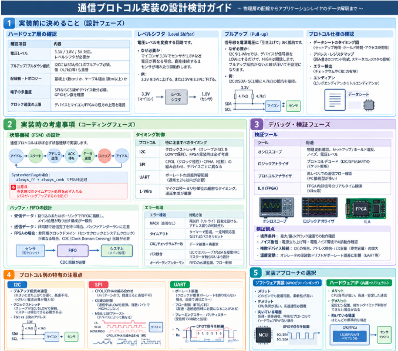

ロボット制御のための[センシング](https://yoshishinnze.hatenablog.com/entry/2026/11/13/043000)を設計する場合の勘所について理解しておきたいと思い、要点を調べました。

>本日はセンシング設計時のノウハウについて説明していきます。

## センサ分野プロトコル大別

センサ分野の通信プロトコルは、**接続する対象・環境・要求性能**によって大きく分かれます。以下、分野ごとに整理して説明します。

### 1. マイコン・FPGA接続（汎用組み込み）

**特徴**: 基板上やデバイス間の短距離通信。最も身近な分野です。

| プロトコル | 主な用途 |
|---|---|
| **I2C** | 温度・湿度・気圧・加速度センサ等。省配線が魅力 |
| **SPI** | 高速IMU、ADC、SDカード。帯域が必要なセンサ |
| **UART** | GPS、Bluetooth、超音波センサ。非同期でシンプル |
| **1-Wire** | 温度センサ（DS18B20）。配線最小化 |
| **PWM入力** | 超音波距離センサ等。パルス幅でデータを受け取る |

### 2. 自動車（車載ネットワーク）

**特徴**: ノイズに強く、信頼性が最優先。長距離配線にも対応。

| プロトコル | 主な用途 |
|---|---|
| **CAN** | エンジン制御、ブレーキ、温度・圧力センサ等。車載の標準 |
| **CAN FD** | CANの後継。より高速・大容量 |
| **LIN** | ドア・シート・ライト周辺の低価格センサ。単線通信 |
| **FlexRay** | ブレーキ・ステアリング等、高速リアルタイム制御が必要な部分 |
| **Automotive Ethernet** | ADASカメラ・LiDAR等、超高速データ転送が必要なセンサ |

### 3. 産業・工場自動化（FA / 産業用）

**特徴**: 長距離・高ノイズ環境。PLC（シーケンサ）との接続が中心。

| プロトコル | 主な用途 |
|---|---|
| **Modbus (RTU/ASCII/TCP)** | 温度・圧力・流量センサ等。産業用の事実標準 |
| **RS-485** | 物理層規格。数百mの長距離通信に対応 |
| **PROFIBUS** | ドイツ発の産業用ネットワーク。工場設備間通信 |
| **PROFINET** | PROFIBUSのEthernet版。より高速 |
| **EtherCAT** | 超高速リアルタイム通信。モーション制御や高精度センサ |
| **IO-Link** | 低価格センサ・アクチュエータの標準化接続。3線式 |

### 4. 航空・宇宙・軍事・鉄道

**特徴**: 極めて高い信頼性・耐環境性が要求される。

| プロトコル | 主な用途 |
|---|---|
| **MIL-STD-1553** | 米軍規格。航空機・宇宙船のセンサ・制御系バス |
| **ARINC 429** | 民間航空機のセンサ・計器通信 |
| **ARINC 664 (AFDX)** | 航空機用Ethernet。ボーイング787、エアバスA380等 |
| **CANaerospace** | 航空機用に拡張したCAN |
| **MVB / WTBus** | 鉄道車両のセンサ・制御通信 |

### 5. 医療機器

**特徴**: 患者安全性・電気的絶縁・小型化が重要。

| プロトコル | 主な用途 |
|---|---|
| **I2C / SPI** | 組み込みセンサ（体温・SpO2・心電等） |
| **USB (HID/CDC)** | 外来用計測機器のPC接続 |
| **Bluetooth (BLE)** | ウェアラブルデバイス（心拍・血圧モニタ等） |
| **ANT+** | フィットネス機器・医療ウェアラブル向け無線 |
| **Zigbee** | 在宅医療センサーネットワーク |
| **専用アナログ** | 心電図・脳波等、高精度アナログセンサ |

### 6. IoT・スマートホーム・無線

**特徴**: 配線不要。低消費電力が重要。

| プロトコル | 主な用途 |
|---|---|
| **Bluetooth Low Energy (BLE)** | スマホ連携センサ、ビーコン |
| **Zigbee** | スマートホームセンサーネットワーク |
| **Z-Wave** | スマートホーム（欧米向け） |
| **LoRa / LoRaWAN** | 数kmの長距離無線。農業・環境モニタリング |
| **NB-IoT / LTE-M** | 携帯回線を使った広域IoTセンサ |
| **Wi-Fi** | カメラ・高帯域センサ |
| **Thread / Matter** | スマートホームの新標準規格 |
| **NFC / RFID** | 近接センサ・タグ読み取り |

### 7. PC / サーバー / データセンター

**特徴**: 内部監視・管理用。

| プロトコル | 主な用途 |
|---|---|
| **SMBus** | バッテリ・温度・電圧監視（I2Cベース） |
| **PMBus** | 電源装置のデジタル管理（SMBus拡張） |
| **Intel DDIO / PCIe** | 高速NIC・加速カード直結 |
| **USB** | 外付けセンサ・計測機器 |

### 8. 音響・映像・画像センサ

**特徴**: 連続的な高速データストリームが必要。

| プロトコル | 主な用途 |
|---|---|
| **I2S (Inter-IC Sound)** | マイク・オーディオDAC等の音声データ |
| **TDM (Time Division Multiplexing)** | 複数チャンネル音声の時分割多重 |
| **MIPI CSI-2** | スマホ・組み込みカメラモジュール接続 |
| **MIPI DSI** | ディスプレイ接続 |
| **HDMI / DisplayPort** | 高解像度映像センサ・モニタ |
| **SLVS-EC / FPD-Link** | 産業用・車載カメラの高速映像伝送 |


### なぜこんなに種類があるのか？

一言で言えば、**「速度・距離・信頼性・コスト・配線本数」のトレードオフ**です。

- 基板上の1cm先のセンサ → SPI/I2C（高速・安価）
- 車のエンジンルームからコクピットへ → CAN（ノイズに強い）
- 工場の反対側のセンサ → RS-485/Modbus（長距離）
- 農地に置いたセンサ → LoRa（無線・数km）


## マイコン・FPGA接続用通信プロトコル
マイコン・FPGA接続用の通信プロトコルはどんな分野でも使うことになる重要度の高い分野と言えます。
本節では、センサ通信プロトコルについて、実用的な観点から整理して説明いたします。

### 1. 全体像

センサとマイコン/FPGAをつなぐ通信プロトコルは、**「何本の線を使うか」と「誰が通信の主導権を持つか」** の違いで大きく分かれます。

簡単なアナロジーで言うと：

- **UART**: 2人が直接電話で話す（1対1、専用線）
- **I2C**: 先生が複数の生徒に順番に話しかける（1本の配線で複数デバイス）
- **SPI**: 司令塔が複数の部下に同時に指示を出す（高速、1対多）
- **1-Wire**: 1本の線で電源もデータも送る（極端に省配線）

### 2. 各プロトコルの仕組み

__UART (Universal Asynchronous Receiver Transmitter)__

**配線**: TX（送信）・RX（受信）の2本 + GND

**特徴**:
- 非同期通信（クロック線が不要）
- 通信速度（ボーレート）を送受信双方で事前に合わせる必要がある
- 1対1通信のみ

**センサ例**: GPSモジュール、距離センサ（LiDAR）、Bluetoothモジュール

**イメージ**: 両者が「1秒に何文字送るか」を事前に約束して、タイミングを合わせて読む。

__I2C (Inter-Integrated Circuit)__

**配線**: SDA（データ）・SCL（クロック）の2本 + GND

**特徴**:
- 同期通信（クロック線でタイミングを共有）
- 1本のバスに複数のデバイスを接続可能（各デバイスに7bitアドレスが割り当てられる）
- マスター（マイコン）が通信の主導権を持つ

**センサ例**: 温度・湿度センサ（SHT系）、加速度センサ（MPU6050）、気圧センサ、EEPROM

**通信の流れ**:
1. マスターが「START」信号を出す
2. 7bitのアドレス + 読み書き方向（1bit）を送信
3. 該当デバイスがACK（応答）を返す
4. データを送受信
5. 「STOP」信号で終了

__SPI (Serial Peripheral Interface)__

**配線**: MOSI（マスター出・スレーブ受）・MISO（スレーブ出・マスター受）・SCLK（クロック）・CS（チップセレクト）+ GND

**特徴**:
- 同期通信、フルデュプレックス（送受信同時）
- 高速通信に強い（I2Cより数倍〜数十倍速い）
- CS線を増やすことで複数デバイスに対応（1デバイスあたり1本のCS線が必要）
- 配線本数はI2Cより多い

**センサ例**: IMU（ICM-20948など高精度品）、SDカード、TFTディスプレイ、高速ADC

**通信の流れ**:
1. CS線をLOWにして対象デバイスを選択
2. SCLKに同期してMOSI/MISOでデータ転送
3. CS線をHIGHにして通信終了

__1-Wire__

**配線**: DQ（データ）1本 + GND（電源もDQ線から供給できるパラサイトモードあり）

**特徴**:
- 極端に配線を減らせる（1本で通信と電源供給）
- 通信速度は低速
- 各デバイスに64bitの固有IDが焼き込まれている

**センサ例**: 温度センサ（DS18B20）、iButton

### 3. 比較表

| 項目 | UART | I2C | SPI | 1-Wire |
|---|---|---|---|---|
| **配線本数** | 2本 | 2本 | 4本+ | 1本 |
| **同期/非同期** | 非同期 | 同期 | 同期 | 非同期 |
| **通信速度** | 中速 | 低速〜中速 | 高速 | 低速 |
| **接続デバイス数** | 1対1 | 複数（アドレス方式） | 複数（CS線方式） | 複数（ID方式） |
| **主導権** | 対等 | マスター主導 | マスター主導 | マスター主導 |
| **強み** | シンプル、長距離 | 省配線・複数接続 | 高速・シンプル制御 | 極限の省配線 |
| **弱み** | 1対1のみ | 速度・バス競合 | 配線本数多い | 低速・特殊 |

### 4. センサ選定時の使い分け

- **複数の温度センサを少ない配線で接続したい** → I2C または 1-Wire
- **IMUの高速サンプリングデータを取りたい** → SPI
- **GPSモジュールと通信したい** → UART
- **配線を極限まで減らしたい** → 1-Wire

## 設計検討

通信プロトコルを実装する際には、**「物理層の配線」から「アプリケーションレイヤのデータ解釈」まで、階層ごとに考慮事項があります**。以下、実装の流れに沿って整理します。

### 1. 実装前に決めること（設計フェーズ）

__ハードウェア層の確認__

| 確認項目 | 内容 |
|---|---|
| **電圧レベル** | 3.3V / 1.8V / 5V 対応。レベルシフタが必要か |
| **プルアップ/プルダウン抵抗** | I2CにはSDA/SCLのプルアップ必須。値（4.7kΩ等）も重要 |
| **配線長・トポロジー** | 基板上（数cm）か、ケーブル経由（数m以上）か |
| **端子の多重度** | SPIならCS線がデバイス数分必要。GPIOピン数を確認 |
| **クロック速度の上限** | デバイスとマイコン/FPGAの双方の上限を確認 |

__レベルシフタ（Level Shifter）__

**何か**: 電圧レベルを変換する回路です。

**なぜ必要か**: マイコンが3.3V動作でセンサが1.8V動作、といったように両者の電圧が異なる場合、直接接続するとセンサが壊れたり誤動作したりします。レベルシフタは両者の間で電圧を翻訳します。

**例**: 3.3Vの信号を5Vに上げる、あるいは5Vを3.3Vに下げる。

__プルアップ（Pull-up）__

**何か**: 抵抗を使って信号線を電源電圧（例: 3.3V）側に「引き上げて」おくことです。

**なぜ必要か**: I2Cや1-Wireなどのプロトコルでは、デバイスが信号線をLOWにするだけで、HIGHは「開放（何もしない）」します。プルアップ抵抗がないと、HIGHのときに線が浮いて不安定になります。抵抗が線をHIGHに保ち、デバイスがLOWに引き下げることで通信が成立します。

**例**: I2CのSDA・SCL線に4.7kΩの抵抗を電源に接続する。


__プロトコル仕様の確認__

- **データシートのタイミング図**: セットアップ時間・ホールド時間・アクセス時間等
- **アドレス・レジスタマップ**: 読み書きのコマンド形式、ステータスレジスタの意味
- **エラー検出**: チェックサムやCRCの有無
- **エンディアン**: データがビッグエンディアンかリトルエンディアンか

### 2. 実装時の考慮事項（コーディングフェーズ）

__状態機械（FSM）の設計__

通信プロトコルはほぼ必ず**状態遷移**で実装します。

```
アイドル → スタート → アドレス送信 → ACK待ち → データ送信 → ストップ → アイドル
```

- **SystemVerilogの場合**: `always_ff` + `always_comb` でFSMを記述
- **注意点**: 各状態でのタイムアウト処理を必ず入れる（バスがハングアップするのを防ぐ）

__タイミング制御__

| プロトコル | 特に注意すべきタイミング |
|---|---|
| **I2C** | クロックストレッチ（スレーブがSCLをLOWで保持）。FPGA実装時は必ず考慮 |
| **SPI** | CPOL（クロック極性）・CPHA（クロック位相）の組み合わせ。デバイスごとに異なる |
| **UART** | ボーレートの誤差許容範囲（通常±2%以内が必要） |
| **1-Wire** | マイクロ秒〜ミリ秒単位の厳密なタイミング。遅延生成が重要 |

__バッファ・FIFOの設計__

- **受信データ**: 割り込みまたはポーリングでFIFOに蓄積し、メイン処理が取り出す構成が一般的
- **送信データ**: 非同期で送信完了を待つ場合、バッファアンダーランに注意
- **FPGAの場合**: 非同期クロックドメイン（センサクロックとシステムクロック）が異なる場合、**CDC（Clock Domain Crossing）回路**が必要

__エラー処理__

| エラー種別 | 対処方法 |
|---|---|
| **NACK（応答なし）** | 再試行（リトライ）回数を設ける。アドレス誤りの可能性も |
| **タイムアウト** | タイマーで監視。一定時間応答なければバスをリセット |
| **CRC/チェックサム不一致** | データ破棄＋再要求 |
| **バス競合** | I2CではスレーブがSDAを駆動中にマスターが触らないよう設計 |
| **オーバーラン/アンダーラン** | FIFOの水準監視、フロー制御 |

### 3. デバッグ・検証フェーズ

__検証ツール__

| ツール | 用途 |
|---|---|
| **オシロスコープ** | 物理波形確認。セットアップ/ホールド違反、ノイズ、電圧レベル |
| **ロジックアナライザ** | プロトコルデコード（I2C/SPI/UARTのパケット解析） |
| **プロトコルアナライザ** | 高レベルでの通信フロー確認（PC接続型が多い） |
| **ILA (Integrated Logic Analyzer)** | FPGA内部信号のリアルタイム観測（Xilinx等） |

__検証観点__

- **境界条件**: 最大/最小クロック速度での動作確認
- **ノイズ耐性**: 電源立ち上げ時・電磁ノイズ環境での誤動作確認
- **複数デバイス接続**: I2Cの場合、アドレス競合・バス容量（寄生容量）の増大
- **温度変動**: オシレータの周波数ドリフトがボーレート誤差に影響（UART等）

### 4. プロトコル別の特有の注意点

__I2C特有__

- **プルアップ抵抗の選定**: 抵抗値が大きいと立ち上がりが遅くなり、高速動作不可。小さすぎると電流消費が増える
- **クロックストレッチ**: 一部のセンサ（安価な温度センサ等）は処理中にSCLをLOWに保持する。FPGAマスターはこれを検出できる必要がある
- **7bit vs 10bitアドレス**: デバイスによって異なる

__SPI特有__

- **CPOL/CPHAの組み合わせ**: デバイスデータシートを正確に読む。組み合わせは4パターンあり、間違えると全く通信できない
- **CS線の制御**: 通信中はLOWを維持。複数バイト連続送信時にHIGHにしないよう注意
- **MSB/LSBファースト**: デバイスによって異なる

__UART特有__

- **ボーレート誤差**: マイコンのクロックが16MHz等、標準ボーレート（115200等）を割り切れない場合、誤差が蓄積して通信エラーになる
- **フロー制御（RTS/CTS）**: 高速・連続通信時に必要になることがある
- **フレーミングエラー・パリティエラー**: 受信側での検出と処理

### 5. 実装アプローチの選択

__ソフトウェア実装（GPIOビットバンギング）__

- **メリット**: どのピンでも使用可能。柔軟性が高い
- **デメリット**: CPU負荷が高い。高速通信は困難
- **向いている場面**: 低速・単発通信。特殊なプロトコルでハードウェアIPがない場合

__ハードウェアIP（MCU/FPGA内蔵ペリフェラル）__

- **メリット**: CPU負荷が低い。高速・安定した通信
- **デメリット**: 固定ピン配置。細かいタイミング制御ができない場合がある
- **向いている場面**: ほとんどの標準的な用途

__専用コントローラ（FPGA内に自作）__

- **メリット**: タイミングを完全に制御可能。複数チャンネル並列処理も可能
- **デメリット**: 設計・検証コストが高い
- **向いている場面**: 先ほどのスチュアートプラットフォームのような高速制御ループ



## 総括

センサ通信プロトコルと設計の勘所を、以下の3点に整理して総括します。

### 1. プロトコルは「速度・距離・信頼性・コスト・配線本数」のトレードオフで選ぶ

| 接続形態 | 代表的プロトコル | 選定基準 |
|---|---|---|
| **マイコン直結** | I2C, SPI, UART, 1-Wire | 基板上の短距離。I2Cは省配線、SPIは高速、UARTはシンプル、1-Wireは極限の省配線 |
| **車載** | CAN, LIN, FlexRay | ノイズ耐性と信頼性が最優先 |
| **産業・工場** | Modbus, RS-485, EtherCAT | 長距離通信とPLC接続。EtherCATは高速リアルタイム制御向け |
| **無線・IoT** | BLE, LoRa, Zigbee | 配線不要・低消費電力が重要 |
| **航空・軍事** | MIL-STD-1553, ARINC | 極めて高い信頼性と耐環境性が必須 |

### 2. マイコン/FPGA接続の4大プロトコルの使い分け

| プロトコル | 配線 | 同期/非同期 | 速度 | 特徴 |
|---|---|---|---|---|
| **UART** | 2本 | 非同期 | 中速 | ボーレート合わせが必要。1対1専用 |
| **I2C** | 2本 | 同期 | 低速〜中速 | プルアップ抵抗必須。アドレスで複数接続 |
| **SPI** | 4本+ | 同期 | 高速 | CPOL/CPHAの組み合わせ確認が必須。CS線で複数接続 |
| **1-Wire** | 1本 | 非同期 | 低速 | 電源もデータ線から供給可能。配線最小化 |

### 3. 実装時の最重要チェック項目

__設計前__
- **電圧レベル**の整合（レベルシフタが必要か）
- **プルアップ抵抗**の有無・値（I2C等）
- **タイミング図**と**レジスタマップ**のデータシート確認
- **エンディアン**と**エラー検出方式**（CRC等）の確認

__コーディング時__
- **FSM（状態機械）** で実装し、必ず**タイムアウト処理**を入れる
- **FIFO/バッファ**設計（受信データの取りこぼし防止）
- **CDC（Clock Domain Crossing）** 対策（FPGAで非同期クロック時）
- **エラー処理**: NACK再試行、CRC不一致、バス競合の検出

__デバッグ時__
- **オシロスコープ**で物理波形・電圧レベル確認
- **ロジックアナライザ**でプロトコルデコード
- **ILA**でFPGA内部信号をリアルタイム観測

### 4. 実装アプローチの選択基準

| アプローチ | 向いている場面 |
|---|---|
| **GPIOビットバンギング** | 特殊プロトコル・低速・柔軟性重視 |
| **MCU/FPGA内蔵ペリフェラル** | 標準的な用途。ほとんどの場合これで十分 |
| **FPGA専用コントローラ自作** | 高速制御ループ・厳密なタイミング制御が必要な場合 |

### 一言総括

> **「センサ通信の設計とは、用途に応じたプロトコル選定と、データシートのタイミング・電気的特性を正確に実装し、エラー処理と検証を怠らないこと」**


