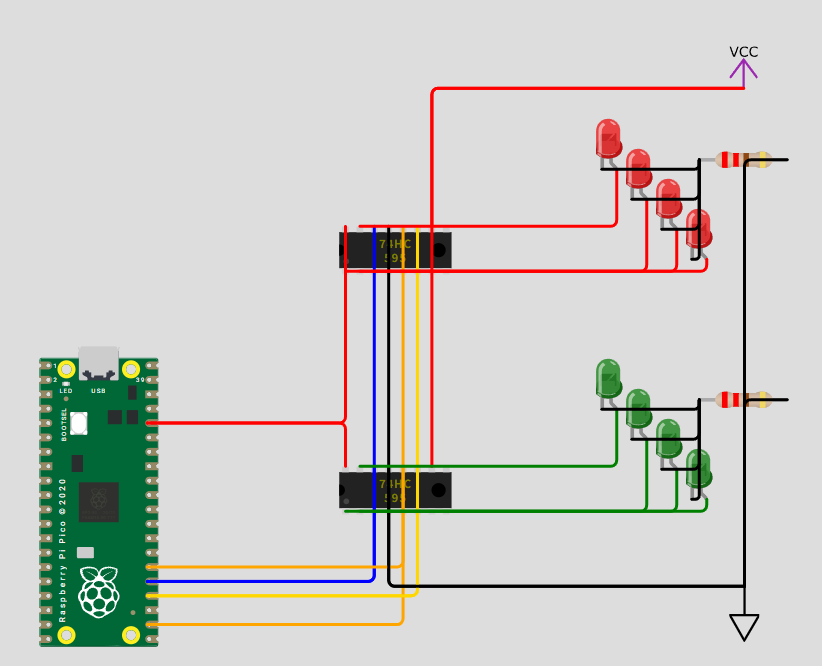
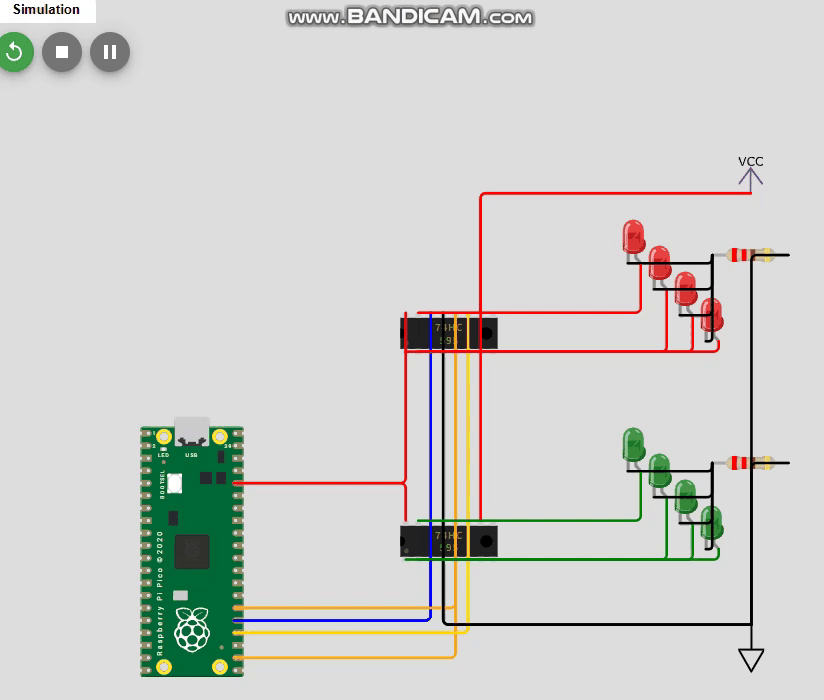

複数センサと[SPI通信](https://yoshishinnze.hatenablog.com/entry/2026/12/11/043000)して制御を行う用途に対して、実践例題を考えて制御法について理解を深めていきたいと思います。

ということで本日お題は、複数センサとSPI通信して制御です。

## SPI通信

SPIの通信や、信号線の構成については[こちらの記事](https://yoshishinnze.hatenablog.com/entry/2026/12/11/043000)を参考下さい。


## SPI通信を複数センサと行う用途

複数の SPI センサーを同じバスに接続して使うケースは、**ロボットの信頼性向上・多軸計測・環境認識の多層化**で頻繁に登場します。以下に代表的な場面を挙げます。

### 1. IMU の冗長化（フェイルセーフ）

ドローンや自律移動ロボットでは、**1つの IMU が故障した場合に墜落・暴走するのを防ぐ**ため、2つ以上の IMU を搭載します。

| センサー1 | センサー2 | 役割 |
|----------|----------|------|
| ICM-20948 | ICM-20948 | 互いのデータを比較し、異常値を検出 |
| 高帯域 IMU | 低ドリフト IMU | 高帯域で衝撃検出、低ドリフトで長期姿勢安定 |

SPI バスは共通、CS ピンだけを分けることで、**同じ配線で冗長計測**が実現できます。

### 2. マニピュレータ（多関節ロボットアーム）の各関節エンコーダ

6軸アームなら**6つのモーター**にそれぞれ磁気エンコーダ（例：AS5048A）を搭載します。各エンコーダは SPI 通信で現在角度を返します。

```
SPIバス（SCK/MOSI/MISO共通）
├── CS1 → 関節1（肩ピッチ）
├── CS2 → 関節2（肩ロール）
├── CS3 → 関節3（肘）
├── CS4 → 関節4（手首ヨー）
├── CS5 → 関節5（手首ピッチ）
└── CS6 → 関節6（手首ロール）
```

**1本の SPI バスで 6 つの角度を順番に読み出す**ことで、配線を最小限に抑えられます。

### 3. 環境センシングの統合（SLAM・ナビゲーション）

自律移動ロボットやドローンが周囲環境を把握するために、複数の SPI センサーを組み合わせます。

| センサー | 測定対象 | 用途 |
|---------|---------|------|
| BME280 | 気圧 | 高度推定（ドローンの高度保持） |
| ICM-20948 | 加速度・ジャイロ・地磁気 | 姿勢推定（EKF入力） |
| TFmini Plus（LiDAR） | 距離 | 障害物検知 |
| ADXL355 | 高分解能加速度 | 微細な振動検知 |

これらを 1 本の SPI バスに接続し、**CS ピンを切り替えて順次データを取得**します。

### 4. 四足歩行ロボットの足先センシング

各足に**力覚センサー（SPI接続）**を搭載し、地面反力を計測します。

- 4 足 × 3 軸力覚センサー = **12 個の SPI スレーブ**
- 同じ SPI バスに CS ピンを 12 本割り当てて順次読み出し
- 各足の接地状態を把握し、歩行パターン（ZMP制御）を調整

### 5. 自動運転・AGV の周囲監視

AGV（無人搬送車）が複数の距離センサーで 360° を監視する場合：

```
SPIバス
├── CS1 → 前方 LiDAR
├── CS2 → 右方 超音波センサー（SPI接続型）
├── CS3 → 左方 超音波センサー
├── CS4 → 後方 ToF センサー
└── CS5 → 床面検知センサー（段差検知）
```

**1 つのマイコンで複数方向の障害物を同時監視**できます。

### なぜ SPI が選ばれるのか

| 比較項目 | SPI | I2C |
|---------|-----|-----|
| 通信速度 | 高速（10MHz 以上） | 中速（400kHz〜3.4MHz） |
| デバイス追加 | CS ピンを増やすだけ | アドレス競合のリスク |
| リアルタイム性 | 高い（クロック同期） | やや低い |
| 配線数 | SCK/MOSI/MISO + CS×n | SDA/SCL のみ |

**高速・リアルタイム・複数接続が必要なロボット制御**では、SPI が有利です。


## 例題の全体像
1本の SPI バスに複数のデバイスをつなぎ、それぞれを独立に制御するという動作をwokwiを用いて実現する例題です。

### 問題設定

Raspberry Pi Pico（マイコン）が 2つの 74HC595（シフトレジスタ）を SPI で制御し、それぞれに接続された LED を別々に点灯させる制御を実装してください。

```
┌─────────────────┐
│  Raspberry Pi   │
│     Pico        │
│                 │
│  GP18 ──────────┼──┬──→ 両方の CLK（共通）
│  GP19 ──────────┼──┬──→ 両方の DS（共通）
│                 │  │    （データ・クロック線は共用）
│  GP17 ──────────┼──┘──→ sr1 の STCP（ラッチ）
│  GP20 ──────────┼─────→ sr2 の STCP（ラッチ）
│                 │       （ラッチ線だけ別々）
└─────────────────┘
       │                  │
    sr1 (74HC595)      sr2 (74HC595)
    ├─ 赤LED × 4       ├─ 緑LED × 4
    │  (led1〜4)       │  (led5〜8)
```

### 動作の流れ（視覚的に）

1. **赤LED1**が点灯 → **緑LED4**が点灯（逆方向）
2. **赤LED2**が点灯 → **緑LED3**が点灯
3. **赤LED3**が点灯 → **緑LED2**が点灯
4. **赤LED4**が点灯 → **緑LED1**が点灯
5. **全LED同時点灯** → **全消灯** → 繰り返し

これにより「1つの SPI バスで、2つのデバイスを完全に独立に制御できている」ことを、LED の動きで一目で確認できます。

### この例題の意義

この構造は、**実機の SPI センサーを複数使う場合と全く同じ**です。

| この例題 | 実機（Raspberry Pi 5） |
|---------|----------------------|
| 74HC595 × 2 | ICM-20948 × 2（または別種の SPI センサー） |
| STCP1 / STCP2 | CS1 / CS2（GPIOピン） |
| 赤LED / 緑LED | 加速度データ / ジャイロデータ 等 |

例えば、Raspberry Pi 5 で 2つの ICM-20948 を SPI で使う場合も：

```
Pi 5 GPIO 11 (SCK)  ───┬──→ 両方の SCL
Pi 5 GPIO 10 (MOSI) ───┬──→ 両方の SDA/SDI
Pi 5 GPIO 8  (CE0)  ───┘──→ センサー1 の CS
Pi 5 GPIO 7  (CE1)  ──────→ センサー2 の CS
```

**CS ピンを分けるだけで、同じ SPI バスに複数のセンサーを接続できる**というのが、この例題で学べる最も重要なことです。

## 実装法

### センサ配置
センサ配置は以下の絵のように `74HC595` × 2 とLEDを配置してください。



```json
{
  "version": 1,
  "author": "Dual SPI 74HC595 Fixed",
  "editor": "wokwi",
  "parts": [
    { "type": "wokwi-pi-pico", "id": "pico", "top": 20, "left": 20, "attrs": {} },
    { "type": "wokwi-74hc595", "id": "sr1", "top": -60, "left": 220, "attrs": {} },
    { "type": "wokwi-74hc595", "id": "sr2", "top": 100, "left": 220, "attrs": {} },
    { "type": "wokwi-led", "id": "led1", "top": -140, "left": 380, "attrs": { "color": "red" } },
    { "type": "wokwi-led", "id": "led2", "top": -120, "left": 400, "attrs": { "color": "red" } },
    { "type": "wokwi-led", "id": "led3", "top": -100, "left": 420, "attrs": { "color": "red" } },
    { "type": "wokwi-led", "id": "led4", "top": -80, "left": 440, "attrs": { "color": "red" } },
    { "type": "wokwi-led", "id": "led5", "top": 20, "left": 380, "attrs": { "color": "green" } },
    { "type": "wokwi-led", "id": "led6", "top": 40, "left": 400, "attrs": { "color": "green" } },
    { "type": "wokwi-led", "id": "led7", "top": 60, "left": 420, "attrs": { "color": "green" } },
    { "type": "wokwi-led", "id": "led8", "top": 80, "left": 440, "attrs": { "color": "green" } },
    { "type": "wokwi-resistor", "id": "r1", "top": -110, "left": 460, "attrs": { "value": "220" } },
    { "type": "wokwi-resistor", "id": "r2", "top": 50, "left": 460, "attrs": { "value": "220" } },
    { "type": "wokwi-gnd", "id": "gnd", "top": 180, "left": 480, "attrs": {} },
    { "type": "wokwi-vcc", "id": "vcc", "top": -180, "left": 480, "attrs": {} }
  ],
  "connections": [
    [ "pico:GP18", "sr1:SHCP", "gold", [] ],
    [ "pico:GP19", "sr1:DS", "blue", [] ],
    [ "pico:GP17", "sr1:STCP", "orange", [] ],
    [ "pico:3V3", "sr1:VCC", "red", [] ],
    [ "pico:GND", "sr1:GND", "black", [] ],
    [ "vcc:VCC", "sr1:MR", "red", [] ],
    [ "gnd:GND", "sr1:OE", "black", [] ],

    [ "pico:GP18", "sr2:SHCP", "gold", [] ],
    [ "pico:GP19", "sr2:DS", "blue", [] ],
    [ "pico:GP20", "sr2:STCP", "orange", [] ],
    [ "pico:3V3", "sr2:VCC", "red", [] ],
    [ "pico:GND", "sr2:GND", "black", [] ],
    [ "vcc:VCC", "sr2:MR", "red", [] ],
    [ "gnd:GND", "sr2:OE", "black", [] ],

    [ "sr1:Q0", "led1:A", "red", [] ],
    [ "sr1:Q1", "led2:A", "red", [] ],
    [ "sr1:Q2", "led3:A", "red", [] ],
    [ "sr1:Q3", "led4:A", "red", [] ],
    [ "led1:C", "r1:1", "black", [] ],
    [ "led2:C", "r1:1", "black", [] ],
    [ "led3:C", "r1:1", "black", [] ],
    [ "led4:C", "r1:1", "black", [] ],
    [ "r1:2", "gnd:GND", "black", [] ],

    [ "sr2:Q0", "led5:A", "green", [] ],
    [ "sr2:Q1", "led6:A", "green", [] ],
    [ "sr2:Q2", "led7:A", "green", [] ],
    [ "sr2:Q3", "led8:A", "green", [] ],
    [ "led5:C", "r2:1", "black", [] ],
    [ "led6:C", "r2:1", "black", [] ],
    [ "led7:C", "r2:1", "black", [] ],
    [ "led8:C", "r2:1", "black", [] ],
    [ "r2:2", "gnd:GND", "black", [] ],

    [ "pico:GP0", "$serialMonitor:RX", "", [] ],
    [ "pico:GP1", "$serialMonitor:TX", "", [] ]
  ]
}
```

### コード

sketch.inoに以下コードを記入してください。

```cpp
// 74HC595 ダブル SPI スレーブ（ソフト SPI）
// SHCP（クロック）と DS（データ）を共通
// STCP（ラッチ = CS相当）だけを別ピンで制御

#define SHCP_PIN  18   // シフトレジスタクロック（共通）
#define DS_PIN    19   // シリアルデータ（共通）
#define STCP1     17   // デバイス1のラッチ
#define STCP2     20   // デバイス2のラッチ

void softSpiBegin() {
  pinMode(SHCP_PIN, OUTPUT);
  pinMode(DS_PIN, OUTPUT);
  pinMode(STCP1, OUTPUT);
  pinMode(STCP2, OUTPUT);
  digitalWrite(SHCP_PIN, LOW);
  digitalWrite(DS_PIN, LOW);
  digitalWrite(STCP1, LOW);
  digitalWrite(STCP2, LOW);
}

// MSB ファーストで 1 バイト送信
void softSpiTransfer(uint8_t data) {
  for (int i = 7; i >= 0; i--) {
    digitalWrite(DS_PIN, (data >> i) & 0x01);
    digitalWrite(SHCP_PIN, HIGH);
    delayMicroseconds(2);
    digitalWrite(SHCP_PIN, LOW);
    delayMicroseconds(2);
  }
}

// 指定した STCP ピンのみでデータをラッチ
void sendTo595(uint8_t stcpPin, uint8_t data) {
  digitalWrite(stcpPin, LOW);
  delayMicroseconds(5);
  softSpiTransfer(data);
  delayMicroseconds(5);
  digitalWrite(stcpPin, HIGH);
  delayMicroseconds(10);
}

void setup() {
  Serial.begin(115200);
  softSpiBegin();

  // 初期状態：全消灯
  sendTo595(STCP1, 0x00);
  sendTo595(STCP2, 0x00);

  Serial.println("[OK] Dual 74HC595 initialized");
}

void loop() {
  // デバイス1：Q0〜Q3 を順番に点灯
  // デバイス2：Q0〜Q3 を逆順に点灯
  for (int i = 0; i < 4; i++) {
    sendTo595(STCP1, 1 << i);           // デバイス1：左から順
    sendTo595(STCP2, 1 << (3 - i));     // デバイス2：右から順
    Serial.print("Dev1=0x"); Serial.print(1 << i, HEX);
    Serial.print(" Dev2=0x"); Serial.println(1 << (3 - i), HEX);
    delay(500);
  }

  // 両方同時に全点灯
  sendTo595(STCP1, 0x0F);
  sendTo595(STCP2, 0x0F);
  Serial.println("Both ON");
  delay(1000);

  // 両方消灯
  sendTo595(STCP1, 0x00);
  sendTo595(STCP2, 0x00);
  Serial.println("Both OFF");
  delay(500);
}
```

__コード制御でしていること__

このコードは、**1本のSPIバスに2つのシフトレジスタ（74HC595）を接続し、それぞれのLEDを独立に制御**です。

__3つの役割分担__

| ピン | 役割 | 接続 |
|------|------|------|
| SHCP（GP18） | クロック | 両方の74HC595で共通 |
| DS（GP19） | データ | 両方の74HC595で共通 |
| STCP1（GP17） | ラッチ | 74HC595-1（赤LED）のみ |
| STCP2（GP20） | ラッチ | 74HC595-2（緑LED）のみ |

__処理の流れ__

__1. `softSpiTransfer(data)`__
8ビットのデータを**1ビットずつ**クロックに同期して送出します。SPIの基本動作です。

__2. `sendTo595(stcpPin, data)`__
指定したラッチピン（STCP）だけをLowにしてデータを送り、Highに戻すことで**そのデバイスだけにデータを反映**します。これが「チップセレクト」の役割です。

__3. `loop()`__
- 赤LED（デバイス1）を左から順に点灯
- 緑LED（デバイス2）を右から順に点灯
- 両方同時に全点灯 → 全消灯を繰り返す

### 動作

こんな感じの動作になります。



## 3つの重要なポイント

### 1. SPI バスは「電車のレール」のようなもの

**SCK（クロック）** と **DS（データ）** は、2つのデバイスで**完全に共通**です。これは「電車が走るレール」に相当し、すべてのデバイスが同じ通信線を見ています。

### 2. CS（ラッチ）ピンが「どのデバイスに話しかけるか」を決める

**STCP1（GP17）** と **STCP2（GP20）** は別々のピンです。

- `STCP1` を Low → High にすると、**sr1（赤LED側）** だけがデータを受け取る
- `STCP2` を Low → High にすると、**sr2（緑LED側）** だけがデータを受け取る

これが SPI の **「チップセレクト（CS）」** の役割です。

### 3. コードで実際に起きていること

```cpp
sendTo595(STCP1, 0x01);  // 赤LED1だけ点灯（sr1だけ反応）
sendTo595(STCP2, 0x08);  // 緑LED4だけ点灯（sr2だけ反応）
```

同じ SPI バスに `0x01` と `0x08` を送っていますが、**ラッチピンを分けて叩く**ことで、赤LEDと緑LEDを完全に独立に制御しています。


## 総括

SPI で複数センサーを使うときの肝は、**「通信線は全デバイスで共有し、CS（チップセレクト）ピンだけを独立に制御する」** ことです。

- **SCK・MOSI・MISO** はすべてのセンサーで共通配線
- **CS ピン**はセンサーごとに別々の GPIO を割り当てる
- CS を Low にしたセンサーだけが、その瞬間のデータを受け取る

つまり、**「同じ配線で順番に話しかける」** ことで、配線を増やさずに複数のセンサーを独立に制御できます。


