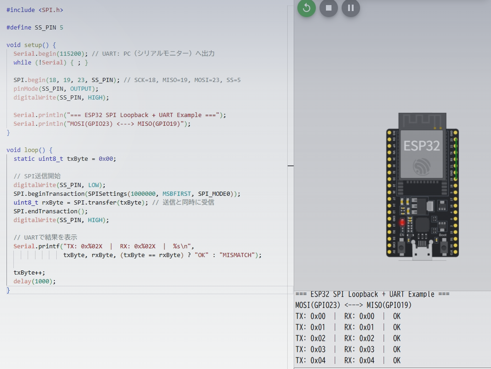
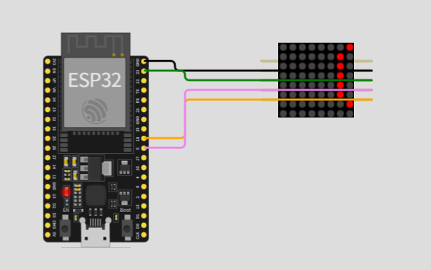

本日はSPI通信の例題2です。
肩慣らしの例題から応用例題を扱います。

因みに、SPI通信については[こちらの記事](https://yoshishinnze.hatenablog.com/entry/2026/12/11/043000)をご覧いただければと思います。

例題の前に[Wokwi](https://wokwi.com/)にログインしてください。

## 例題A：ESP32単体 / SPI Loopback + UART（手軽な動作確認用）

### 問題設定

通常、SPI通信はマイコンと別のIC（センサーやメモリなど） を繋いでデータのやり取りをします。
しかし、通信相手を置かず、ESP32の送信端子（MOSI）と受信端子（MISO）を1本のジャンパ線で直結しています。
これをループバック（折り返し）接続と呼びます。自分が出した信号をそのまま自分で受け取る構造です。

この構成では、ESP32内部で以下の動作が毎秒1回、繰り返されることになります。

1. SPIでデータを送信
 
ESP32が0x00、0x01、0x02…という数字を1バイトずつMOSI端子（GPIO23）へ出力します。

2. 信号を折り返して受信
 
回路図でMOSI（GPIO23）とMISO（GPIO19）が接続されているため、出した信号がそのままMISO端子へ入ってきます。

3. 受信データを確認
 
ESP32はSPIの受信バッファからデータを読み出します。

4. UARTでPCに報告

Serial.printf()を使い、「送ったデータ」と「受け取ったデータ」をシリアルモニターに表示します。

### 回路構成（diagram.json）
Wokwiのエディタで「ESP32 DevKit v1」を配置し、`diagram.json`を以下のように設定します。  
（`esp:23`（MOSI）と`esp:19`（MISO）を1本の緑線で接続するだけです。）

```json
{
  "version": 1,
  "author": "User",
  "editor": "wokwi",
  "parts": [
    { "type": "board-esp32-devkit-c-v4", "id": "esp", "top": 0, "left": 0, "attrs": {} }
  ],
  "connections": [
    [ "esp:23", "esp:19", "green", [ "h0" ] ]
  ]
}
```

### ESP32 スケッチ（Master & Loopback）
```cpp
#include <SPI.h>

#define SS_PIN 5

void setup() {
  Serial.begin(115200); // UART: PC（シリアルモニター）へ出力
  while (!Serial) { ; }
  
  SPI.begin(18, 19, 23, SS_PIN); // SCK=18, MISO=19, MOSI=23, SS=5
  pinMode(SS_PIN, OUTPUT);
  digitalWrite(SS_PIN, HIGH);
  
  Serial.println("=== ESP32 SPI Loopback + UART Example ===");
  Serial.println("MOSI(GPIO23) <---> MISO(GPIO19)");
}

void loop() {
  static uint8_t txByte = 0x00;
  
  // SPI送信開始
  digitalWrite(SS_PIN, LOW);
  SPI.beginTransaction(SPISettings(1000000, MSBFIRST, SPI_MODE0));
  uint8_t rxByte = SPI.transfer(txByte); // 送信と同時に受信
  SPI.endTransaction();
  digitalWrite(SS_PIN, HIGH);
  
  // UARTで結果を表示
  Serial.printf("TX: 0x%02X  |  RX: 0x%02X  |  %s\n", 
                txByte, rxByte, (txByte == rxByte) ? "OK" : "MISMATCH");
  
  txByte++;
  delay(1000);
}
```

### 期待されるシリアル出力



```
=== ESP32 SPI Loopback + UART Example ===
MOSI(GPIO23) <---> MISO(GPIO19)
TX: 0x00  |  RX: 0x00  |  OK
TX: 0x01  |  RX: 0x01  |  OK
TX: 0x02  |  RX: 0x02  |  OK
...
```


## パターンB：ESP32による流し表示

次の例題は、**「PCのキーボードで入力した文字を、LEDのドットマトリクス画面に流し表示（スクロール）する」**システムを、1台のESP32で作ってみます。


### 全体の目的（何が起きるのか？）

1. Wokwiの**シリアルモニター**に文字を打ってEnterを押す
2. その文字が**ESP32に送られる**（UART通信）
3. ESP32が文字を**LEDの点灯パターン**に変換する
4. ESP32が**SPI通信**でLEDマトリクス（MAX7219）にデータを送る
5. 8x8のLEDマトリクス上で、文字が**右から左へ流れて表示**される


### 2つの通信を同時に使っている点がポイント

この例題の特徴は、**UARTとSPIという性質の違う通信を、1つのマイコン内で同時に使っている**ことです。

| 通信 | 相手 | 役割 | イメージ |
|------|------|------|----------|
| **UART** | PC（シリアルモニター） | 人間が文字を入力するための「受信口」 | お客さんが注文を伝える受話器 |
| **SPI** | LEDマトリクス（MAX7219） | ドットの点灯データを高速で送る「配線」 | 厨房へ注文内容を一気に伝える専用回線 |

### 具体的な処理の流れ

__① PCから文字を受け取る（UART）__
```
人間：「HELLO」とタイプ → シリアルモニター → ESP32（UART受信）
```

__② 文字をドット絵に変換__

ESP32の中に「H」や「E」などの文字を**5x7ドットのパターン**として定義した表（フォントデータ）があります。  
「H」なら縦7ドット×横5ドットのビットマップに変換します。

```
'H' →  0x7F,0x08,0x08,0x08,0x7F  （フォントデータ）
```

__③ スクロール用の画像を組み立てる__

8x8のLEDマトリクスには1文字しか入りません。複数文字を流したいので、ESP32は **「今は全体の文字列のどの部分を切り出して表示するか」** を計算します。

```
全体：「HELLO 」
表示中：「 HE」（8ドット幅に切り出した部分）
次の瞬間：「HEL」
…
```

__④ LEDマトリクスに送る（SPI）__

組み立てた8x8ドットの画像を、**8行（1行=1バイト）×SPI転送**でMAX7219に送ります。

```
SPI.transfer(レジスタ番号);  // どの行に書くか
SPI.transfer(点灯パターン);    // その行の8ドットのON/OFF
```

__⑤ 100msごとに少しずつずらす__

`millis()` で時間を計り、100msごとに表示開始位置を1ドットずつ進めます。これが**スクロール（流し表示）**になります。

### なぜSPIを使うのか？

LEDマトリクス制御IC（MAX7219）は、**「どの行に」「どのパターンを」** という16ビットの命令を受け取ります。この命令を高速に送るのにSPIは最適です。

- クロック同期なので**速くて確実**
- `CS`（Chip Select）をLOWにしている間に**連続で複数バイト送れる**
- ソフトウェアで1ビットずつ操作するより**圧倒的に速い**


### 回路構成（diagram.json）

```json
{
  "version": 1,
  "author": "User",
  "editor": "wokwi",
  "parts": [
    { "type": "board-esp32-devkit-c-v4", "id": "esp", "top": 0, "left": 0, "attrs": {} },
    { "type": "wokwi-max7219-matrix", "id": "matrix", "top": -29.25, "left": 189.53, "attrs": { "chain": "1" } }
  ],
  "connections": [
    [ "esp:5V", "matrix:VCC", "red", [ "h30", "v-20" ] ],
    [ "esp:GND.2", "matrix:GND", "black", [ "h30", "v20" ] ],
    [ "esp:23", "matrix:DIN", "green", [ "h40", "v-10" ] ],
    [ "esp:18", "matrix:CLK", "orange", [ "h40", "v0" ] ],
    [ "esp:5", "matrix:CS", "violet", [ "h40", "v10" ] ]
  ]
}
```

### ESP32スケッチ（sketch.ino）

ちょっと長いですが、以下のコードをスケッチに指定下さい。

```cpp
#include <SPI.h>

// MAX7219 レジスタ定義
#define REG_NOOP       0x00
#define REG_DIGIT0     0x01
#define REG_DIGIT1     0x02
#define REG_DIGIT2     0x03
#define REG_DIGIT3     0x04
#define REG_DIGIT4     0x05
#define REG_DIGIT5     0x06
#define REG_DIGIT6     0x07
#define REG_DIGIT7     0x08
#define REG_DECODE     0x09
#define REG_INTENSITY  0x0A
#define REG_SCANLIMIT  0x0B
#define REG_SHUTDOWN   0x0C
#define REG_TEST       0x0F

#define CS_PIN 5

// 5x7 フォント（ASCII 0x20〜0x7F）
static const uint8_t font5x7[][5] = {
  {0x00,0x00,0x00,0x00,0x00}, // 0x20 スペース
  {0x00,0x5E,0x00,0x00,0x00}, // 0x21 !
  {0x00,0x07,0x00,0x07,0x00}, // 0x22 "
  {0x14,0x3E,0x14,0x3E,0x14}, // 0x23 #
  {0x24,0x2A,0x7F,0x2A,0x12}, // 0x24 $
  {0x23,0x13,0x08,0x64,0x62}, // 0x25 %
  {0x36,0x49,0x55,0x22,0x50}, // 0x26 &
  {0x00,0x00,0x07,0x00,0x00}, // 0x27 '
  {0x00,0x1C,0x22,0x41,0x00}, // 0x28 (
  {0x00,0x41,0x22,0x1C,0x00}, // 0x29 )
  {0x2A,0x1C,0x7F,0x1C,0x2A}, // 0x2A *
  {0x08,0x08,0x3E,0x08,0x08}, // 0x2B +
  {0x00,0xA0,0x60,0x00,0x00}, // 0x2C ,
  {0x08,0x08,0x08,0x08,0x08}, // 0x2D -
  {0x00,0x60,0x60,0x00,0x00}, // 0x2E .
  {0x20,0x10,0x08,0x04,0x02}, // 0x2F /
  {0x3E,0x51,0x49,0x45,0x3E}, // 0x30 0
  {0x00,0x42,0x7F,0x40,0x00}, // 0x31 1
  {0x62,0x51,0x49,0x49,0x46}, // 0x32 2
  {0x22,0x41,0x49,0x49,0x36}, // 0x33 3
  {0x18,0x14,0x12,0x7F,0x10}, // 0x34 4
  {0x27,0x45,0x45,0x45,0x39}, // 0x35 5
  {0x3C,0x4A,0x49,0x49,0x30}, // 0x36 6
  {0x01,0x71,0x09,0x05,0x03}, // 0x37 7
  {0x36,0x49,0x49,0x49,0x36}, // 0x38 8
  {0x06,0x49,0x49,0x29,0x1E}, // 0x39 9
  {0x00,0x36,0x36,0x00,0x00}, // 0x3A :
  {0x00,0xA6,0x66,0x00,0x00}, // 0x3B ;
  {0x00,0x1C,0x22,0x41,0x00}, // 0x3C <
  {0x14,0x14,0x14,0x14,0x14}, // 0x3D =
  {0x00,0x41,0x22,0x1C,0x00}, // 0x3E >
  {0x02,0x01,0x59,0x09,0x06}, // 0x3F ?
  {0x3E,0x41,0x5D,0x55,0x1E}, // 0x40 @
  {0x7E,0x11,0x11,0x11,0x7E}, // 0x41 A
  {0x7F,0x49,0x49,0x49,0x36}, // 0x42 B
  {0x3E,0x41,0x41,0x41,0x22}, // 0x43 C
  {0x7F,0x41,0x41,0x22,0x1C}, // 0x44 D
  {0x7F,0x49,0x49,0x49,0x41}, // 0x45 E
  {0x7F,0x09,0x09,0x09,0x01}, // 0x46 F
  {0x3E,0x41,0x49,0x49,0x7A}, // 0x47 G
  {0x7F,0x08,0x08,0x08,0x7F}, // 0x48 H
  {0x00,0x41,0x7F,0x41,0x00}, // 0x49 I
  {0x20,0x40,0x41,0x3F,0x01}, // 0x4A J
  {0x7F,0x08,0x14,0x22,0x41}, // 0x4B K
  {0x7F,0x40,0x40,0x40,0x40}, // 0x4C L
  {0x7F,0x02,0x0C,0x02,0x7F}, // 0x4D M
  {0x7F,0x04,0x08,0x10,0x7F}, // 0x4E N
  {0x3E,0x41,0x41,0x41,0x3E}, // 0x4F O
  {0x7F,0x09,0x09,0x09,0x06}, // 0x50 P
  {0x3E,0x41,0x51,0x21,0x5E}, // 0x51 Q
  {0x7F,0x09,0x19,0x29,0x46}, // 0x52 R
  {0x26,0x49,0x49,0x49,0x32}, // 0x53 S
  {0x01,0x01,0x7F,0x01,0x01}, // 0x54 T
  {0x3F,0x40,0x40,0x40,0x3F}, // 0x55 U
  {0x1F,0x20,0x40,0x20,0x1F}, // 0x56 V
  {0x3F,0x40,0x38,0x40,0x3F}, // 0x57 W
  {0x63,0x14,0x08,0x14,0x63}, // 0x58 X
  {0x07,0x08,0x70,0x08,0x07}, // 0x59 Y
  {0x61,0x51,0x49,0x45,0x43}, // 0x5A Z
  {0x00,0x7F,0x41,0x41,0x00}, // 0x5B [
  {0x02,0x04,0x08,0x10,0x20}, // 0x5C \
  {0x00,0x41,0x41,0x7F,0x00}, // 0x5D ]
  {0x04,0x02,0x01,0x02,0x04}, // 0x5E ^
  {0x40,0x40,0x40,0x40,0x40}, // 0x5F _
  {0x00,0x01,0x02,0x04,0x00}, // 0x60 `
  {0x20,0x54,0x54,0x54,0x78}, // 0x61 a
  {0x7F,0x48,0x44,0x44,0x38}, // 0x62 b
  {0x38,0x44,0x44,0x44,0x28}, // 0x63 c
  {0x38,0x44,0x44,0x48,0x7F}, // 0x64 d
  {0x38,0x54,0x54,0x54,0x18}, // 0x65 e
  {0x08,0x7E,0x09,0x01,0x02}, // 0x66 f
  {0x18,0xA4,0xA4,0xA4,0x7C}, // 0x67 g
  {0x7F,0x08,0x04,0x04,0x78}, // 0x68 h
  {0x00,0x44,0x7D,0x40,0x00}, // 0x69 i
  {0x20,0x40,0x44,0x3D,0x00}, // 0x6A j
  {0x7F,0x10,0x28,0x44,0x00}, // 0x6B k
  {0x00,0x41,0x7F,0x40,0x00}, // 0x6C l
  {0x7C,0x04,0x78,0x04,0x78}, // 0x6D m
  {0x7C,0x08,0x04,0x04,0x78}, // 0x6E n
  {0x38,0x44,0x44,0x44,0x38}, // 0x6F o
  {0x7C,0x14,0x14,0x14,0x08}, // 0x70 p
  {0x08,0x14,0x14,0x18,0x7C}, // 0x71 q
  {0x7C,0x08,0x04,0x04,0x08}, // 0x72 r
  {0x48,0x54,0x54,0x54,0x24}, // 0x73 s
  {0x04,0x3F,0x44,0x40,0x20}, // 0x74 t
  {0x3C,0x40,0x40,0x20,0x7C}, // 0x75 u
  {0x1C,0x20,0x40,0x20,0x1C}, // 0x76 v
  {0x3C,0x40,0x30,0x40,0x3C}, // 0x77 w
  {0x44,0x28,0x10,0x28,0x44}, // 0x78 x
  {0x0C,0x50,0x50,0x50,0x3C}, // 0x79 y
  {0x44,0x64,0x54,0x4C,0x44}, // 0x7A z
  {0x00,0x08,0x36,0x41,0x00}, // 0x7B {
  {0x00,0x7F,0x00,0x00,0x00}, // 0x7C |
  {0x00,0x41,0x36,0x08,0x00}, // 0x7D }
  {0x08,0x08,0x2A,0x1C,0x08}, // 0x7E ~
};

// スクロール制御用変数
String scrollText = "HELLO I2C SPI UART! "; // 初期表示文字列
const int COL_WIDTH = 6; // 5ドット + 1ドットスペース
const int MAX_TEXT_LEN = 100;
uint8_t frameBuffer[8];    // MAX7219へ書き込む8行分バッファ
int scrollOffset = 0;
unsigned long lastScrollTime = 0;
const unsigned long SCROLL_DELAY_MS = 100; // スクロール速度

// MAX7219へレジスタ書き込み（SPI使用）
void max7219Write(uint8_t reg, uint8_t data) {
  digitalWrite(CS_PIN, LOW);
  SPI.transfer(reg);
  SPI.transfer(data);
  digitalWrite(CS_PIN, HIGH);
}

// MAX7219初期化
void max7219Init() {
  max7219Write(REG_SHUTDOWN,  0x01); // Normal operation
  max7219Write(REG_TEST,      0x00); // Display test off
  max7219Write(REG_INTENSITY, 0x03); // 輝度（0x00〜0x0F）
  max7219Write(REG_SCANLIMIT, 0x07); // 全桁（0〜7）をスキャン
  max7219Write(REG_DECODE,    0x00); // デコードなし（マトリクス用）
  clearDisplay();
}

// 画面クリア
void clearDisplay() {
  for (uint8_t i = 0; i < 8; i++) {
    max7219Write(REG_DIGIT0 + i, 0x00);
  }
}

// 文字列をビットマップ列に展開して8列分をframeBufferに取り出す
void updateFrameBuffer() {
  int textLen = scrollText.length();
  if (textLen == 0) return;

  // 各列を計算
  for (uint8_t row = 0; row < 8; row++) {
    uint8_t colData = 0x00;
    
    for (uint8_t col = 0; col < 8; col++) {
      int globalCol = scrollOffset + col;
      
      // 文字インデックスと文字内の列を計算
      int charIndex = globalCol / COL_WIDTH;
      int charCol   = globalCol % COL_WIDTH;
      
      // 文字列を繰り返し表示（無限スクロール）
      charIndex = charIndex % textLen;
      char c = scrollText[charIndex];
      
      uint8_t pixel = 0;
      if (charCol < 5 && c >= 0x20 && c <= 0x7E) {
        pixel = (font5x7[c - 0x20][charCol] >> row) & 0x01;
      }
      // charCol == 5 はスペース（1ドット空白）
      
      colData |= (pixel << (7 - col));
    }
    frameBuffer[row] = colData;
  }
}

// frameBufferをMAX7219へSPI送信
void refreshDisplay() {
  for (uint8_t row = 0; row < 8; row++) {
    max7219Write(REG_DIGIT0 + row, frameBuffer[row]);
  }
}

void setup() {
  Serial.begin(115200); // UART: PC（シリアルモニター）との通信
  while (!Serial) { ; }
  
  SPI.begin(18, 19, 23, CS_PIN); // SCK=18, MISO=19, MOSI=23, SS=5
  pinMode(CS_PIN, OUTPUT);
  digitalWrite(CS_PIN, HIGH);
  
  max7219Init();
  
  Serial.println("=== ESP32 SPI + UART LED Matrix Example ===");
  Serial.println("Type text and press ENTER to scroll on MAX7219");
  Serial.println("Initial text: \"" + scrollText + "\"");
}

void loop() {
  // --- UART入力処理 ---
  if (Serial.available()) {
    String input = Serial.readStringUntil('\n');
    input.trim();
    if (input.length() > 0 && input.length() <= MAX_TEXT_LEN) {
      scrollText = input + " "; // 末尾にスペースを追加
      scrollOffset = 0;         // スクロール位置をリセット
      Serial.println("New scroll text: \"" + scrollText + "\"");
    } else if (input.length() > MAX_TEXT_LEN) {
      Serial.println("Error: Text too long (max 100 chars)");
    }
  }

  // --- スクロール表示処理（SPI使用）---
  unsigned long now = millis();
  if (now - lastScrollTime >= SCROLL_DELAY_MS) {
    lastScrollTime = now;
    
    updateFrameBuffer();
    refreshDisplay(); // SPIでMAX7219へ送信
    
    scrollOffset++;
    // 1文字分進んだらループ
    if (scrollOffset >= (int)scrollText.length() * COL_WIDTH) {
      scrollOffset = 0;
    }
  }
}
```

### 実行

- `max7219Write()` 内の `SPI.transfer(reg)` と `SPI.transfer(data)` が、**1回のCSアサート期間中に連続して2バイト送信**される典型的なSPIデバイス制御パターンです。
- MAX7219は「レジスタアドレス + データ」の16ビットフレームを受け取ります。
- UARTからの入力を受けるたびに `scrollOffset` をリセットしているため、文字列が切り替わる際も自然に先頭から流れ始めます。



### この例題で学べること

| 要素 | 内容 |
|------|------|
| **SPI通信** | `SPI.begin()`, `SPI.transfer()` を使い、MAX7219のレジスタに直接データを書き込む |
| **UART通信** | `Serial.readStringUntil()` でPCから文字列を受信 |
| **デバイス制御** | レジスタアドレス指定、初期化シーケンス、画面クリアなどの実装 |
| **データ変換** | 文字列 → フォントビットマップ → スクロールフレームバッファの生成 |
| **リアルタイム処理** | `millis()` による非同期スクロールとUART受信の並行処理 |

## 総括

本日の内容は、**ESP32を使った「SPI通信の基礎確認」と「実用的なデバイス制御」の2本立て**でした。


__例題A：SPI Loopback + UART__

ESP32の**送信端子（MOSI）と受信端子（MISO）を1本の線で直結**し、自分で出したデータを自分で受け取ります。送受信値が一致すればSPIの動作が正常であることが確認でき、その結果を**UART（シリアルモニター）** でPCに表示します。外部パーツ不要で、**SPI通信の動作テスト**として使います。

__例題B：LEDマトリクスの流し表示__

PCから**UARTで文字列**を受け取り、ESP32内部で**5×7ドットのフォント**に変換します。そして**SPI**でLEDマトリクス制御IC（MAX7219）に送信し、文字を右から左へ**スクロール表示**します。

### 本質のまとめ

| 役割 | SPI | UART |
|------|-----|------|
| **用途** | LEDマトリクスなどの「機器を速く制御する」 | PCの「人間が見て操作する」入出力 |
| **例題A** | 自分宛てにデータを送受信して動作確認 | 結果を表示 |
| **例題B** | ドットパターンを高速でLEDに転送 | 表示する文字列を入力 |

**SPIは「機器への高速な指令伝達」、UARTは「人間とのおしゃべり窓口」** という分担です。

