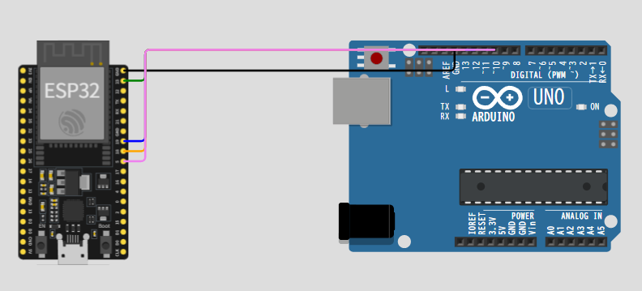

本日はSPI通信とUART通信両方を用いる例題を考えてみました。

## パターンA：ESP32単体 / SPI Loopback + UART（手軽な動作確認用）

### 問題設定

通常、SPI通信はマイコンと別のIC（センサーやメモリなど） を繋いでデータのやり取りをします。
しかし、通信相手を置かず、ESP32の送信端子（MOSI）と受信端子（MISO）を1本のジャンパ線で直結しています。
これをループバック（折り返し）接続と呼びます。自分が出した信号をそのまま自分で受け取る構造です。

この構成では、ESP32内部で以下の動作が毎秒1回、繰り返されることになります。

1. SPIでデータを送信
 
ESP32が0x00、0x01、0x02…という数字を1バイトずつMOSI端子（GPIO23）へ出力します。

2. 信号を折り返して受信
 
回路図でMOSI（GPIO23）とMISO（GPIO19）が接続されているため、出した信号がそのままMISO端子へ入ってきます。

3. 受信データを確認
 
ESP32はSPIの受信バッファからデータを読み出します。

4. UARTでPCに報告

Serial.printf()を使い、「送ったデータ」と「受け取ったデータ」をシリアルモニターに表示します。

### 回路構成（diagram.json）
Wokwiのエディタで「ESP32 DevKit v1」を配置し、`diagram.json`を以下のように設定します。  
（`esp:23`（MOSI）と`esp:19`（MISO）を1本の緑線で接続するだけです。）

```json
{
  "version": 1,
  "author": "User",
  "editor": "wokwi",
  "parts": [
    { "type": "board-esp32-devkit-c-v4", "id": "esp", "top": 0, "left": 0, "attrs": {} }
  ],
  "connections": [
    [ "esp:23", "esp:19", "green", [ "h0" ] ]
  ]
}
```

### ESP32 スケッチ（Master & Loopback）
```cpp
#include <SPI.h>

#define SS_PIN 5

void setup() {
  Serial.begin(115200); // UART: PC（シリアルモニター）へ出力
  while (!Serial) { ; }
  
  SPI.begin(18, 19, 23, SS_PIN); // SCK=18, MISO=19, MOSI=23, SS=5
  pinMode(SS_PIN, OUTPUT);
  digitalWrite(SS_PIN, HIGH);
  
  Serial.println("=== ESP32 SPI Loopback + UART Example ===");
  Serial.println("MOSI(GPIO23) <---> MISO(GPIO19)");
}

void loop() {
  static uint8_t txByte = 0x00;
  
  // SPI送信開始
  digitalWrite(SS_PIN, LOW);
  SPI.beginTransaction(SPISettings(1000000, MSBFIRST, SPI_MODE0));
  uint8_t rxByte = SPI.transfer(txByte); // 送信と同時に受信
  SPI.endTransaction();
  digitalWrite(SS_PIN, HIGH);
  
  // UARTで結果を表示
  Serial.printf("TX: 0x%02X  |  RX: 0x%02X  |  %s\n", 
                txByte, rxByte, (txByte == rxByte) ? "OK" : "MISMATCH");
  
  txByte++;
  delay(1000);
}
```

### 期待されるシリアル出力


```
=== ESP32 SPI Loopback + UART Example ===
MOSI(GPIO23) <---> MISO(GPIO19)
TX: 0x00  |  RX: 0x00  |  OK
TX: 0x01  |  RX: 0x01  |  OK
TX: 0x02  |  RX: 0x02  |  OK
...
```


## パターンB：ESP32（Master + UART）↔ Arduino Uno（SPI Slave）

次は実践的な例です。
ESP32とArduino Unoという2台のマイコンをSPIで実際に繋ぎ、双方向のデータ通信を行い、その結果をUART（シリアルモニター）で確認する実験です。
一つ目の「自分で自分に送る」自己診断とは異なり、こちらは本番に近い「デバイス間通信」のテンプレートとなります。
ESP32がSPIでArduino Unoにデータを送り、Unoは受信データに`+1`して返信します。ESP32はUARTで送受信結果をシリアルモニターに表示します。

### 回路構成（diagram.json）

Wokwi上に2台のマイコンを配置し、以下のように役割を分担しています。

1. ESP32（SPI Master / 主）

通信のタイミングを管理し、クロック（SCK）を出力しながらデータを送る側です。同時に、UARTでPCのシリアルモニターに結果を出力します。

2. Arduino Uno（SPI Slave / 従）

ESP32からのクロック信号に合わせてデータを受け取り、割り込み処理で即座に返信データを準備する側です。

__通信内容__

4本の信号線（MOSI, MISO, SCK, SS）で両者を接続し、さらにGNDを共通にすることで、電気信号の基準を合わせています。

SPIは「全二重（フルデュプレックス）」通信なので、 1クロックのタイミングで同時に双方向へデータが流れます。

SPIにはMOSIとMISOという独立した2本のデータ線があります。

- MOSI（Master Out Slave In）: マスター（ESP32）がスレーブ（Uno）へ送る線
- MISO（Master In Slave Out）: スレーブ（Uno）がマスター（ESP32）へ送る線

この2本が別々にあるため、マスターがデータを送るクロックのタイミングと同じ瞬間に、スレーブもデータを返すことができます。



```json
{
  "version": 1,
  "author": "User",
  "editor": "wokwi",
  "parts": [
    { "type": "board-esp32-devkit-c-v4", "id": "esp", "top": 0, "left": 0, "attrs": {} },
    { "type": "wokwi-arduino-uno", "id": "uno", "top": 0, "left": 300, "attrs": {} }
  ],
  "connections": [
    [ "esp:GND.2", "uno:GND.1", "black", [ "h0" ] ],
    [ "esp:23", "uno:11", "green", [ "h20", "v20" ] ],
    [ "esp:19", "uno:12", "blue", [ "h20", "v20" ] ],
    [ "esp:18", "uno:13", "orange", [ "h20", "v20" ] ],
    [ "esp:5", "uno:10", "violet", [ "h20", "v20" ] ]
  ]
}
```

### ESP32側コード（SPI Master + UART出力）
```cpp
#include <SPI.h>

#define SS_PIN 5

void setup() {
  Serial.begin(115200); // UART: デバッグ出力用
  while (!Serial) { ; }
  
  SPI.begin(18, 19, 23, SS_PIN); // SCK, MISO, MOSI, SS
  pinMode(SS_PIN, OUTPUT);
  digitalWrite(SS_PIN, HIGH);
  
  Serial.println("=== ESP32 SPI Master + UART Monitor ===");
}

void loop() {
  static uint8_t count = 0;
  
  digitalWrite(SS_PIN, LOW);
  SPI.beginTransaction(SPISettings(4000000, MSBFIRST, SPI_MODE0));
  uint8_t reply = SPI.transfer(count); // countを送信し、同時にreplyを受信
  SPI.endTransaction();
  digitalWrite(SS_PIN, HIGH);
  
  // UARTでPCに結果を出力
  Serial.printf("Sent: 0x%02X, Received: 0x%02X (expected: 0x%02X)\n", 
                count, reply, (uint8_t)(count + 1));
  
  count++;
  delay(800);
}
```

### Arduino Uno側コード（SPI Slave）
Wokwi上でUnoのスケッチとして設定します。

```cpp
#include <SPI.h>

volatile uint8_t recvByte = 0;
volatile uint8_t sendByte = 0xFF;
volatile bool newData = false;

void setup() {
  Serial.begin(115200);
  
  pinMode(MISO, OUTPUT); // SlaveはMISOを出力に設定
  SPCR |= _BV(SPE);      // SPI有効化（Slaveモード）
  SPCR |= _BV(SPIE);     // SPI割り込み有効化
  
  Serial.println("Arduino Uno SPI Slave ready");
}

// SPI転送完了割り込み
ISR(SPI_STC_vect) {
  recvByte = SPDR;       // 受信バッファから読み出し
  sendByte = recvByte + 1; // 次の送信データを準備
  SPDR = sendByte;       // 次の転送データをセット
  newData = true;
}

void loop() {
  if (newData) {
    newData = false;
    // Uno側のUARTにも受信内容を表示（Wokwiでは別タブで確認可能）
    Serial.print("Slave received: 0x");
    Serial.println(recvByte, HEX);
  }
}
```

### 動作の流れ
1. ESP32がUART（115200bps）で初期メッセージをPCに出力
2. ESP32がSPIで`0x00, 0x01, 0x02...`をArduino Unoへ送信
3. UnoはSPI割り込みでデータを受け取り、`+1`した値をESP32に返信
4. ESP32は受信した値（`0x01, 0x02, 0x03...`）をUARTでシリアルモニターに表示

---

## Wokwiでの使い方のヒント

- **ESP32のUART**：Wokwiでは`Serial.begin(115200)`を使うと、自動的にUSB-UARTブリッジ経由でシリアルモニターに出力されます。シミュレーター下部の「Serial Monitor」タブで確認できます。
- **SPIのピン番号**：
  - ESP32 DevKit：`SCK=GPIO18`, `MISO=GPIO19`, `MOSI=GPIO23`
  - Arduino Uno：`SCK=13`, `MISO=12`, `MOSI=11`, `SS=10`
- **GND共有**：2台以上のマイコンを接続する場合、必ずGND同士を接続してください（上記`diagram.json`に含まれています）。

パターンAはすぐに動作確認できるシンプルな構成、パターンBは実際のマイコン間通信のテンプレートとして使えます。